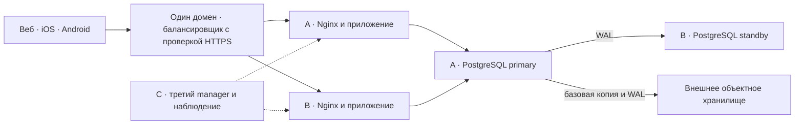

# Три провайдера для 1Padel: доступность, стоимость и переход к микросервисам

Архитектурное предложение от 27 ноября 2026 года для обсуждения с владельцем. [Задача LFPT-1451](https://github.com/UstinKO/padel-core-service/issues/1451) · [Раздел бэклога](https://github.com/UstinKO/padel-core-service/milestone/12)

**Рекомендация.** Сохранить действующую ВМ за $20, добавить у второго провайдера узел с приложением и тёплым резервом PostgreSQL, у третьего — небольшой узел для кворума и наблюдения. Начать с двух реплик приложения **на весь кластер**, по одной на разных площадках. Заложить **до $66 в месяц** на три ВМ, входящий трафик через балансировщик, внешние копии и сопутствующие расходы. Первый отдельный сервис, который стоит испытать после этого, — доставка уведомлений. Регистрация, места в турнире и учёт оплаты пока выигрывают от одной транзакции.

## От чего отталкиваемся

Инвентаризация 19 ноября зафиксировала Compose, одну JVM, 2 vCPU и 3911 MiB RAM. На момент замера приложение занимало 734 MiB, PostgreSQL — около 63 MiB, весь хост имел около 2 GiB доступной памяти. Это ориентир для выбора стенда. Потребление в турнирный пик, задержка между будущими площадками и месячный объём журнала PostgreSQL требуют измерения. В односерверном плане уже разобраны две реплики, Redis для сессий и квот, доставка live-событий между репликами и восстановление томов. [Инвентаризация и ресурсы](../swarm/README.md) · [ADR односерверного Swarm](../swarm/adr/0001-single-vm.md) · [Репетиция восстановления](../swarm/data-recovery.md)

Принятое направление разработки — многомодульный монолит с одной исполняемой сборкой. Выделение хранения по #1051 меняет зависимости Java. Для физического резерва БД можно использовать тот же образ приложения. Предлагаемый здесь следующий этап имеет собственное условие запуска и отдельное решение о переключении. [MASTER](../../specs/MASTER.md) · [Фаза 6](../modular-monolith/phase-6/README.md) · [Исторический план выделения сервисов](../microservices-migration-plan.md)

## Какую доступность покупаем

90% за 30 суток допускают **72 часа** простоя. Это нижняя граница владельца. Для турнирного дня предлагаю рабочую цель **99% за скользящие 30 суток** — 7 ч 12 мин простоя, включая обслуживание. На 99,9% остаются 43 мин 12 с. Обещать такой уровень при ручном переключении БД и одном дежурном можно только после истории реальных инцидентов и учений.

Считать доступность глазами игрока. Каждую минуту внешняя проба проходит через публичный домен и читает расписание, вторая проверяет авторизованный путь и возможность записи в выделенный тестовый объект с очисткой. Минута успешна, если оба сценария вернули правильный результат за согласованный таймаут (для пилота 5 с). Пробелы измерений отмечать отдельно и включать в бюджет как неизвестный простой. Доступность = успешные минуты / все минуты. Второй независимый наблюдатель помогает отличить сбой измерителя. Отдельно показывать ошибки и p95 из Аргентины, разрывы live-табло и простой во время турниров. Один ответ CDN со статикой не подтверждает возможность записаться.

| Вариант | Что получаем | Когда имеет смысл |
|---|---|---|
| Одна ВМ за текущие $20 и внешний backup | Минимум расходов и сопровождения. При потере ВМ весь сервис ждёт восстановления | Если фактический SLO уже ≥90% и бизнес принимает простой до восстановления, это самый дешёвый вариант |
| **Три провайдера, две рабочие реплики и один резерв БД** | Потерю одной ВМ с приложением переживает вторая. При потере основного PostgreSQL дежурный переключает запись | Предлагаемый баланс для турниров, если подтверждены связь между площадками и доступность дежурного |
| Две JVM на каждом из трёх серверов, автоматическое переключение БД | Шесть процессов переживают локальные рестарты, но больше расходуют RAM и соединения. Автоматизация БД требует отдельного кворума и надёжной изоляции прежнего primary | Когда стенд показывает нехватку одной JVM в режиме отказа или ручное переключение исчерпывает бюджет простоя |

## Размещение и путь запроса

Один Swarm, три manager-узла, по одному у каждого провайдера. Для изменений в кластере нужны два связанных manager из трёх. Кворум Swarm управляет контейнерами. Право принимать запись в PostgreSQL определяется отдельно. При потере кворума имеющиеся задачи могут продолжить работу, а перепланирование и выпуск версий ждут восстановления управления. [Руководство Docker по кворуму](https://docs.docker.com/engine/swarm/admin_guide/)

| Узел | Нормальное размещение | Ресурс для выбора тарифа |
|---|---|---|
| A, нынешний провайдер | Manager, Nginx, приложение, основной PostgreSQL, Redis primary и Sentinel | Нынешние 2 vCPU / около 4 GiB. Проверить CPU, память и диск на полном пике с одной JVM |
| B, второй провайдер | Manager, Nginx, приложение, PostgreSQL standby на своём диске, Redis replica и Sentinel | Ориентир 4 vCPU / 8 GB. Должен потянуть всю запись, входящие запросы и фоновые задачи при потере A |
| C, третий провайдер | Manager, третий Sentinel, метрики с коротким хранением. Сигнал о недоступности самого C отправляет внешний наблюдатель | Начать с 1 vCPU / 2 GiB, ограничить мониторинг. Если ему тесно, сначала сократить срок хранения и частоту сбора |

* **Вход.** На A и B по локальному Nginx. Внешний балансировщик проверяет каждый origin на готовность локального приложения обслужить основной сценарий с действующей БД. Успешная проверка возвращает ожидаемое тело и HTTP 200. У каждого origin свой адрес, корректные TLS и Host. В штатном режиме можно предпочесть A, чтобы сократить межплощадочные SQL-вызовы. B получает регулярные пробы полного пути. Для двух рабочих узлов ограничить размещение меткой и максимумом в одну app task на узел. Локальная маршрутизация проверки исключает ситуацию, когда неисправный origin выглядит здоровым за счёт соседа. [Пример балансировки с проверкой origin](https://developers.cloudflare.com/terraform/tutorial/use-load-balancing/)
* **Межплощадочная сеть.** Между A, B и C — попарные шифрованные каналы без центрального VPN-хаба. Управление Swarm, overlay, PostgreSQL, Redis и межрепличный REST доступны по закрытой сети. Использовать стабильные адреса узлов и проверить MTU под реальным HTTPS/WebSocket и передачей WAL. Подбирать близкие друг к другу площадки с независимыми сетями и приемлемым маршрутом для игроков из Аргентины. Две площадки на разных континентах могут сделать обычную регистрацию с несколькими последовательными SQL-запросами медленной.
* **Состояние приложения.** Для Spring Session и квот испытать Redis A/B и три Sentinel с кворумом 2. Клиент приложения должен находить новый primary после переключения. Асинхронная репликация допускает потерю недавней сессии или счётчика. Для чувствительных операций при недоступном хранилище нужен контролируемый отказ или консервативный лимит. Проверить сохранение входа, OAuth и повторный вход при потере сессии. После обрыва WS/STOMP клиент переподключается, запрашивает актуальный снимок и продолжает получать межрепличные события по принятой схеме #1211. [Redis Sentinel](https://redis.io/docs/latest/operate/oss_and_stack/management/sentinel/) · [Текущий контракт live](../endpoints/public-live.md)
* **Совместная работа реплик.** Для cron и Telegram polling назначить одного активного исполнителя с передачей роли, для очередей — атомарный захват записи с истечением аренды. Для регистрации, оплаты и отправки нужен устойчивый ключ операции и обработка повторов. Развёртывать по одной реплике, сначала вывести её из маршрутизации, затем проверить готовность новой версии. Миграции Liquibase выполняет один владелец, изменения схемы совместимы с обеими версиями на время обновления. Контролировать сумму пулов подключений всех JVM. [План Swarm и реестр фоновых задач](../swarm/README.md)

Три независимых одноузловых Swarm также возможны. Они позволяют обслуживать каждую площадку при плохой связи между провайдерами, но требуют трёх отдельных выпусков и внешнего управления переключением. Если на стенде общий Swarm теряет кворум при типичных задержках или во время backup, выгоднее сохранить действующий кластер и держать отдельно развёртываемый тёплый резерв, пока не найдутся подходящие площадки.

## Данные и действия при отказе

На первом этапе предлагаю **один пишущий PostgreSQL и ручное повышение резервного**. У каждого экземпляра свой закреплённый локальный диск. Запуск контейнера на пустом томе другого узла не восстанавливает базу. Асинхронная потоковая репликация экономит межплощадочную задержку на каждой записи. Цена выбора — возможность потерять уже подтверждённую операцию при аварии primary. Для пилота предлагаю RPO ≤5 мин (возраст утраченных данных) и RTO ≤30 мин (от начала аварии до подтверждённой работы чтения и записи). Это цели учений. При долгом разрыве связи асинхронный резерв может отстать сильнее. Если владелец требует сохранить каждую подтверждённую оплату, отдельно испытать синхронный standby и остановку записи при потере связи. [Репликация PostgreSQL 15](https://www.postgresql.org/docs/15/warm-standby.html) · [Переключение и изоляция прежнего primary](https://www.postgresql.org/docs/15/warm-standby-failover.html)

| Отказ | Что увидит игрок | Действие и критерий восстановления |
|---|---|---|
| Процесс приложения или Nginx | Часть запросов и WS-соединений оборвётся | Балансировщик переводит запросы на здоровый origin. Цель стенда ≤3 мин. Повтор одной записи создаёт одну регистрацию |
| Весь A, включая основной PostgreSQL | Пока дежурный восстанавливает запись, динамические сценарии недоступны | Подтвердить изоляцию A через независимое управление провайдера, проверить последнюю позицию WAL на B и допустимую потерю. Повысить B, сменить внутреннюю точку подключения, обновить пулы и проверить тестовую запись. Сверить операции за окно потери |
| Весь B | A продолжает обслуживать трафик, остаётся без тёплого резерва | Убрать B из входящего трафика, проверить архив WAL, следить за диском A, восстановить standby и сравнить позиции журналов |
| Весь C | A и B обслуживают клиентов, сохраняют большинство. Часть телеметрии пропадёт | Внешняя проба оповещает дежурного. Восстановить третий manager и Sentinel до следующих работ |
| Разделение сети, включая изоляцию A от B+C | A может оставаться доступным через интернет и продолжать запись. Большинство Swarm на B+C само по себе не даёт права повысить БД | Оставить одного писателя. Если выключение или полная изоляция старого primary не подтверждены, повышение отложить, остановить опасные записи. Вернуть бывший primary только как заново синхронизированный standby |
| Ошибка релиза, порча данных, сбой edge или две потерянные площадки | Реплики наследуют ошибку релиза или данных, единый внешний вход также может отказать | Откатить совместимый образ, при порче восстановить БД на момент до ошибки и сверить записи. Для сбоя edge заранее проверить резервный порядок смены маршрутизации и TLS. При потере двух узлов восстановить управление по отдельной процедуре и проверить единственность писателя |

**Внешняя копия обязательна даже при здоровом standby.** Еженедельная физическая базовая копия плюс непрерывный архив WAL в зашифрованное объектное хранилище отдельной учётной записи. Предлагаемое окно восстановления — 14 дней с базовой копией, покрывающей его начало. Контролировать возраст последнего архивированного WAL и свободный диск, в том числе во время низкого трафика. Ключ восстановления хранить отдельно, задать срок защиты копий от удаления. Раз в месяц поднимать чистую БД и проверять турнир, регистрацию, оплату и содержимое чека. Файлы чеков уже лежат в PostgreSQL как `BYTEA`. Отдельно восстанавливать конфигурацию, необходимые секреты и состояние Swarm из закрытых копий. [Восстановление на момент времени](https://www.postgresql.org/docs/15/continuous-archiving.html) · [Схема хранения чеков](../../src/main/resources/db/changelog/versions/v1.89-telegram-payment-receipts.yaml)

Дежурному нужны три независимых сигнала — доступность записи снаружи, задержка подтверждённого WAL на B и возраст последнего WAL во внешнем архиве. Для проверки RPO использовать периодическую контрольную запись с номером и временем даже в тихие часы. Поднимать тревогу при отставании более 2 мин. При выходе за 5 мин владелец выбирает между приостановкой критичных записей и явным принятием большего окна потерь. Без дежурного время реакции входит в RTO и может занять часы.

## Месячная смета в долларах США

Оценка на 27.11.2026 для малой нагрузки. Нижняя публичная цена служит ориентиром. Бюджетировать стоит по правой колонке и итоговой корзине для доступных регионов, включая условия продления.

| Статья | Основание | План, $/мес. |
|---|---|---:|
| A — действующая ВМ | Текущая аренда по данным владельца | 20 |
| B — OVHcloud VPS-2 | 4 vCore / 8 GB / 75 GB, публично от $8,50. Предел закупки учитывает условия региона и срока. [OVHcloud](https://us.ovhcloud.com/vps/) | 16 |
| C — DigitalOcean Basic Regular | 1 vCPU / 2 GiB / 50 GiB, фиксированный пакет. [DigitalOcean](https://www.digitalocean.com/pricing/droplets) | 12 |
| Балансировка двух origin и проверки | Бюджетный лимит для тарифа в действующем аккаунте, стоимость зависит от опций и запросов. [Cloudflare Load Balancing](https://www.cloudflare.com/products/load-balancing/) | 8 |
| Внешний backup | Например, при 100 GB среднего объёма хранение B2 по $6,95/TB стоит около $0,70 до дополнительных операций. Заложен запас на рост и чтение. [Backblaze B2](https://www.backblaze.com/cloud-storage/pricing) | 3 |
| Резерв | Налоги, IPv4, исходящий трафик, хранение логов, пробное восстановление или внешняя проба | 7 |
| **Итого** | **$48 на серверы и $18 на остальное** | **66** |

Рост относительно текущей аренды — **до $46/мес.**, остаток до верхней границы — **$4**. При цене B $8,50 и остальных заложенных суммах получится $58,50. Если действующий провайдер совпадёт с B или C либо не подойдёт по задержке, полностью именованный вариант — A на AWS Lightsail Linux с IPv4 (4 GB / 2 vCPU за $24), B на OVHcloud, C на DigitalOcean. По консервативной смете это ровно $70. На месяц переезда отдельно учесть пересечение старой и новой аренды. Рабочее время дежурного, публикация в магазинах приложений и платные сервисы рассылки лежат за пределами серверной сметы. [Тарифы AWS Lightsail](https://aws.amazon.com/lightsail/pricing/)

**Если нужны две реплики на каждом сервере**, это шесть JVM. По разовому замеру только их память суммарно составит около 4,3 GiB, по 1,43 GiB на хост до пиков, ОС и БД. Для такой схемы C стоит пересчитать минимум на 4 GiB / 2 vCPU ($24 в указанной линейке). По консервативному бюджету получаем $78 ещё до изменения опций входа. При минимальной цене B — $70,50. Шесть реплик не дают второй копии базы сверх предусмотренной и не добавляют четвёртой независимой площадки. Если это обязательное условие, проверять по две локальные задачи на каждом узле, Hikari-пулы и стоимость трёх origin, прежде чем выбирать тариф.

## Переход по шагам и критерии решения

1. **Снять исходные метрики и выбрать площадки.** За неделю, включающую турнир, измерить доступность записи и расписания, p95, максимум одновременных WS, расход RAM, WAL в сутки и объём счетов. На временных ВМ проверить попарные RTT, потери, MTU и маршруты из Аргентины. Сравнить p95 регистрации с локальным baseline. Стартовый порог для обсуждения — рост ≤20% при той же нагрузке. При выходе за порог попробовать более близкие регионы. Сверить независимость операторов и аренду без долгой предоплаты.
2. **Проверить три узла на синтетическом турнире.** Сначала восстановить копию в изоляции. Затем нагрузить стенд реальным профилем пика, поочерёдно выключить A, B, C и разорвать только межплощадочную сеть. Для каждого опыта записать время оповещения, реакции человека, восстановления записей и последнее подтверждённое событие. Проверить повтор регистрации, отметку оплаты, сессии, повторную доставку уведомления и восстановление live после переподключения. На одной оставшейся рабочей ВМ требуется выдержать полный пик минимум 30 мин, без OOM, с ≥512 MiB доступной памяти. Владелец отдельно согласует допустимую потерю данных и покрытие дежурств в дни турниров.
3. **Переключать трафик после учений.** Сначала поднять резерв и внешний backup, проверить восстановление, затем включить B для пробных запросов и малой доли трафика. Критерии расширения — доступность записи, согласованные p95/RTO/RPO, успешный тест потери A и прогноз расходов ≤$70. Для отката приложения вывести новый origin, вернуть предыдущий совместимый образ. После записи на повышенном B продолжать писать на B до обратной синхронизации и планового переключения. Простое возвращение старого тома потеряет новые записи.
4. **Выделить доставку уведомлений при измеренной потребности.** Сигнал — сбои внешних каналов или отставание рассылки мешают турнирам, либо релизы доставки регулярно требуют обновлять весь сервер. Ядро в транзакции регистрации сохраняет версионированное событие в outbox. Отдельно выпускаемый сервис получает события через узкий контракт и владеет своими попытками, ключами дедупликации и статусами доставки. Первоначально достаточно отдельной схемы и роли в том же кластере PostgreSQL. Учесть опыт `MarketingOutbox`, проверить его пригодность для каждого нового канала. Переключать одного потребителя флагом после теневой сверки без отправки, при откате передать очередь обратно с сохранением ключей. Если внешний канал принял сообщение до обрыва ответа, возможен повтор. Контролировать возраст очереди, повторы и время до доставки. Расход памяти и трафика нового процесса повторно включить в смету.

После выделения ядро остаётся на A и B. Для доставки сначала достаточно одного перезапускаемого обработчика с допустимым размещением на A или B и резервом ресурсов на обеих ВМ. Он забирает события пакетами через внутренний интерфейс ядра с подтверждением обработки. Во время его перезапуска события накапливаются, регистрация продолжает работать. Если очередь в часы турниров выходит за согласованный срок доставки, испытать второй обработчик на другом узле с раздельным захватом событий. Переезд его схемы на отдельный сервер имеет смысл при доказанной конкуренции за диск или независимых требованиях к восстановлению.

Для iOS и Android уже есть клиент Expo/React Native. Обе платформы могут обращаться к тому же HTTPS API, что и веб, через один домен. Поддерживать опубликованные версии контракта и проверять минимум текущий и предыдущий мобильные релизы. После таймаута при записи клиент запрашивает статус операции и повторяет её с тем же ключом. Кэшированное расписание можно показать офлайн с временем обновления, подтверждение места приходит с сервера. Push через APNs/FCM можно добавить как канал службы уведомлений. [Мобильный клиент](../../mobile-app/package.json) · [Контракт расписания](../endpoints/public-schedule.md)

**Решение для владельца.** Финансировать сначала стендовую проверку потери A и восстановление из независимой копии. Разрешать постоянную аренду и переключение после трёх результатов — приемлемой задержки из Аргентины, восстановления записи в согласованный срок с известной потерей данных и подтверждённой корзины до $70. Фактическую месячную доступность можно будет оценить после первого полного окна наблюдения.
