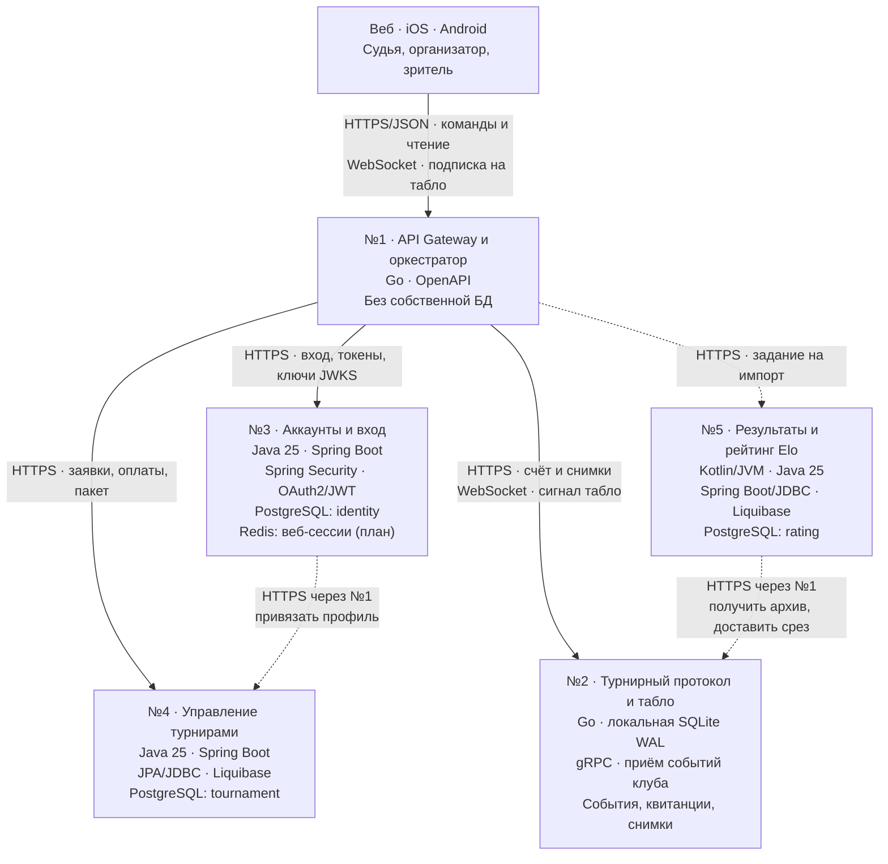
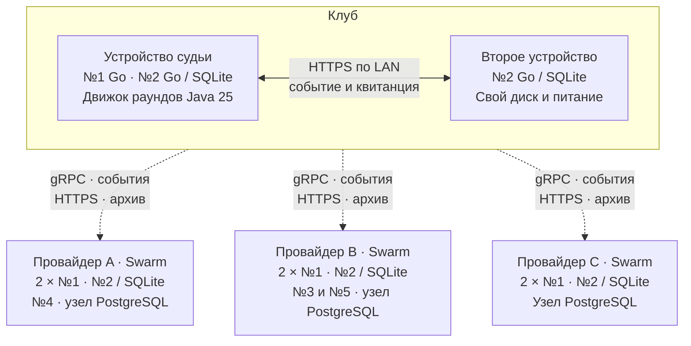
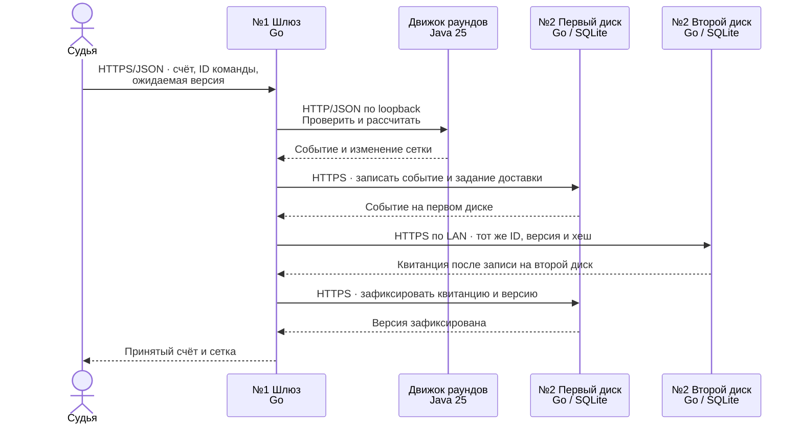
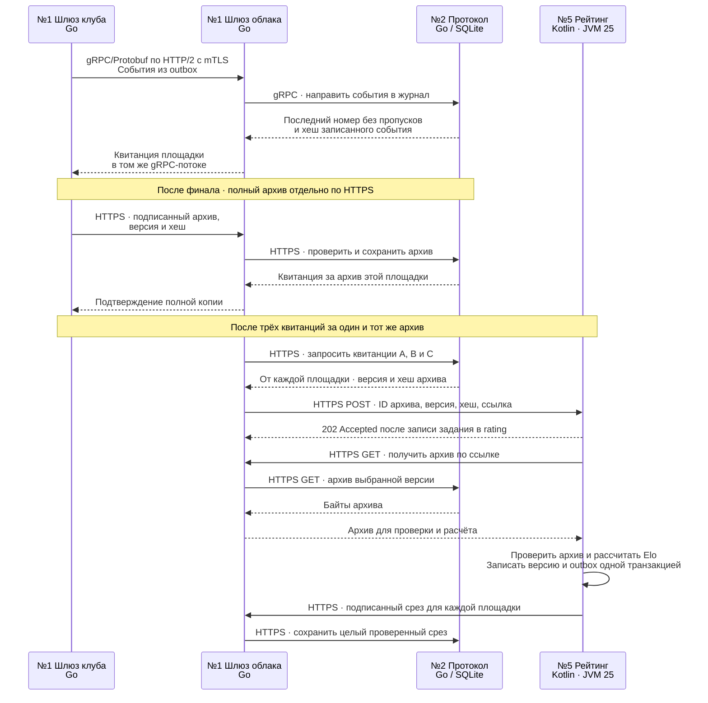

# Карта архитектуры турнирного сервиса

Согласованная архитектура пилота состоит из пяти сервисов. Судья ведёт подготовленный турнир в клубе, облачные площадки принимают события и обслуживают зрителей, официальный Elo рассчитывается после полной архивации. В теневом пилоте официальный рейтинг продолжает публиковать действующая система.

## Пять сервисов и их контракты

Стрелка показывает, кто инициирует вызов. Сплошная линия означает запрос с ожиданием результата, пунктирная — работу, которую система выполняет в фоне. Связи между прикладными сервисами показаны по отправителю и получателю. Внутренние сетевые вызовы идут по маршрутам оркестратора с взаимной аутентификацией.

№1 проверяет известный действующий JWT по открытому ключу, а №4 проверяет право на конкретный турнир. Учётные данные, заявки с оплатами и версии Elo принадлежат разным сервисам. У №3–5 отдельные роли и схемы в **одной облачной базе PostgreSQL**. №1 хранит маршруты и открытые ключи в кеше, состояние незавершённой операции восстанавливает по ID у её владельца. [Данные, доступ и контракты пяти сервисов](data-and-contracts.md)

## Где работают экземпляры

Числа №1–5 на всех схемах обозначают одни и те же сервисы. Для стенда предусмотрены три ВМ у независимых провайдеров, у каждой собственный одноузловой Docker Swarm. Шлюз управляет тремя независимыми отправками. По gRPC идут события и встречные квитанции, по HTTPS — полный финальный архив.

На одном сервере две реплики шлюза обращаются к одному владельцу локального журнала. Квитанции облачного архива считаются по независимым площадкам. Три узла PostgreSQL образуют один кластер. Для критичных облачных изменений запись подтверждают основной узел (primary) и обе реплики (standby). При недоступности площадки облачная заявка или оплата может ждать подтверждения. Клубному пути проведения нужны два исправных локальных устройства и LAN. Размещение прикладных процессов на A и B предстоит проверить под нагрузкой. [Размещение и бюджет](README.md) · [Порядок выделения процессов](service-boundaries.md#размещение-порядок-выделения-и-приёмка)

## От кнопки судьи до подтверждённого счёта

Подписанный пакет до старта выдаёт №4 через №1. Он содержит состав, права устройства и версию правил. Клубный движок поставляется вместе с правилами №4 и вызывается локально. Писать новые версии активного турнира вправе одно судейское устройство.

SQLite использует WAL и `synchronous=FULL`. Публикация локальной версии разрешает фоновую доставку из журнала исходящих операций (outbox). Если ответ судье потерялся, клиент запрашивает состояние по тому же ID. При отсутствии второй записи ввод остаётся неподтверждённым. Облачный PostgreSQL, Redis и расчёт Elo в этом пути не участвуют. [Контракт команды и поведение экрана](gateway-and-services.md#как-проходит-запись-счёта)

## От принятого события до официального Elo

На схеме облачный №2 обозначает экземпляр протокола на одной площадке. Доставка повторяется независимо для A, B и C. Облачный №1 принимает внутренние вызовы и маршрутизирует их к сервису-владельцу.

Квитанция за номер события подтверждает прогресс gRPC-потока. Для запуска импорта нужны **три отдельные квитанции за полный архив**. Ответ `202 Accepted` означает, что задание сохранено. Зритель получает через №1 последнюю целиком опубликованную версию из №2, а WebSocket сообщает об обновлении табло. По согласованному пилоту gRPC применяется только к потоку событий и квитанций. Пакетный HTTPS служит контролем при сравнении скорости. [Условия испытаний транспорта](data-and-contracts.md#оценка-потокового-grpc-для-турнирного-дня) · [Протокол пилота](pilot-checks.md)
