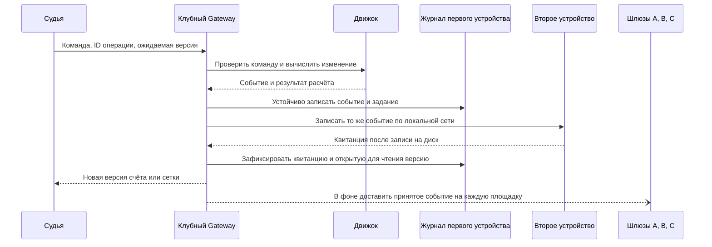

# Единый шлюз, состав сервисов и время ответа

Предложение для стенда LFPT-1451. Судья вводит счёт и переходит к следующему матчу. В обычном сценарии единственный видимый результат операции — изменившийся счёт, место или сетка. Шлюз берёт на себя выбор маршрута, получение второй долговечной копии и последующую синхронизацию. [Условия сохранности, модель отказов и смета](README.md)

## Чем управляет оркестратор

**API Gateway и оркестратор — один логический компонент и один версионированный API для веба, iOS и Android.** Он принимает команды, проверяет полномочия, направляет запрос владельцу данных и возобновляет незавершённые операции. Движок турнира отвечает за допустимость счёта и состав следующего раунда. Хранилище отвечает за запись и квитанции. Сервис рейтинга отвечает за порядок применения турниров. Swarm на каждой облачной площадке запускает и перезапускает процессы.

Для проведения турнира экземпляр шлюза работает на судейском ноутбуке. Ещё по два лёгких экземпляра обслуживают вход на каждой из площадок A, B и C. Облачные экземпляры могут обслуживать один контракт параллельно. Право изменять активный турнир закреплено за одним клубным устройством. Облачный экземпляр, получивший судейскую команду во время автономного проведения, может направить её владельцу только при доступном маршруте. Самостоятельно присваивать ей следующий номер ему запрещено. Эта граница сохраняет одну историю при разделе сети.

На старте судейский клиент получает подписанный пакет, доверенные адреса шлюза и ключи проверки. В клубе он автоматически связывается с локальным экземпляром по защищённому каналу. Пилот включает проверку TLS, разрешений мобильной ОС и открытия уже установленного интерфейса без внешнего DNS, CDN и OAuth. Публичные клиенты обычно используют один домен. Резервные адреса и повтор с тем же ID работают в подготовленных клиентах. Первое посещение сайта из обычного браузера всё ещё зависит от доступности домена и доставки страницы. Историю команд, выбранного владельца и фоновые задания можно восстановить после перезапуска шлюза с диска площадки.

## Сервисы и их контракты

Шлюз и протокол работают в клубе и на облачных площадках. Для облачной прикладной части предлагаются три независимо перезапускаемых процесса на тех же ВМ. Основания для такого состава — текущие транзакции, стоимость вычислений и последствия отказа. [Разбор пяти областей по коду и нагрузке](service-boundaries.md)

| Компонент | Где работает и чем владеет | Стек и взаимодействие |
|---|---|---|
| **Шлюз с оркестратором** | Клуб и A/B/C. Маршруты, версия контракта, проверка подписи и роли, координация записи и восстановления по ID операции | Предложение для пилота — Go, стандартный HTTP-сервер, HTTPS/JSON и OpenAPI. Каждый запрос получает ID для трассировки. Квитанции и состояние операции сохраняет протокол. На облачных узлах существующий Nginx может завершать TLS. [HTTP в Go](https://pkg.go.dev/net/http) |
| **Проведение и расчёт раундов** | Локальный модуль клубного приложения. По текущей версии турнира и команде возвращает проверенное изменение. В облаке те же правила используются для проверки и воспроизведения | Java 17 и существующие классы движков. На судейском ноутбуке небольшой локальный Java-процесс, один вызов по loopback. Нужные зависимости формата включаются в пакет заранее. Существующие Java-вызовы внутри движка сохраняются. [Турнирные движки](../../padel-tournament-engines/src/main/java/com/padle/core/padelcoreservice/service) |
| **Турнирный протокол и табло** | Судейское и второе клубное устройство, A/B/C. Единственный владелец журнала на площадке, порядка событий, квитанций и готового снимка для чтения | Go, HTTPS/JSON, SQLite на локальном диске. Для записи — транзакция, WAL, `synchronous=FULL`, уникальные ID операций и версий. На ВМ две реплики входа обращаются к одному локальному владельцу журнала. Между площадками передаются события. Табло получает сигнал по WebSocket и читает готовый снимок. [Долговечность SQLite](https://www.sqlite.org/pragma.html#pragma_synchronous) · [Ограничения WAL](https://www.sqlite.org/wal.html) |
| **Аккаунты и вход** | Облако. Создание аккаунта, вход, восстановление доступа, OAuth и выдача токенов | Java 17, Spring Security и PostgreSQL. Шлюз направляет запросы входа по внутреннему HTTPS. Для уже выданного токена проверяет подпись локально по открытому ключу. Браузерный поток сохраняет сессии и CSRF. |
| **Управление турнирами** | Облако. Клубы, заявка на участие, очередь, права на конкретный турнир, оплаты, подготовка судейского пакета и интеграции | Действующее приложение на Spring Boot, Java 17, PostgreSQL и Liquibase. Шлюз вызывает API по HTTPS. Изменения заявок и оплат с общими инвариантами фиксируются одной транзакцией. [Конфигурация сборки](../../pom.xml) |
| **Результаты и рейтинг** | Облако. Отдельный фоновый процесс для применения проверенного архива и публикации версий Elo | Java 17 и PostgreSQL. Оркестратор ставит задание после трёх квитанций о полном архиве. Шлюзы читают последнюю целиком доставленную версию среза. [Правила пересчёта](../../specs/done/LFPT-1034-elo-preview-recalculation.md) |

Веб и Expo/React Native для iOS и Android используют одну спецификацию. В первом пилоте телефон может быть судейским терминалом, а запись на диск выполняют два подготовленных клубных устройства. Фоновые ограничения телефона не должны лишить клуб второй копии. Отправка писем, Telegram и возможные мобильные push остаются отдельными фоновыми потребителями по их продуктовым правилам. Для внутренней доставки на старте достаточно транзакционной очереди исходящих событий (outbox) и HTTP-получателей. Отдельный брокер или отдельная БД для каждого Java-модуля добавили бы постоянный расход ресурсов. [Мобильный клиент](../../mobile-app/package.json) · [Границы модулей](../modular-monolith/README.md)

## Как проходит запись счёта

Шлюз сериализует команды одного турнира и проверяет ожидаемую версию при записи. При таймауте или перезапуске он находит операцию по ID, сверяет хеш и квитанцию второго устройства, повторяет недостающий шаг. После локальной фиксации новой версии журнал открывает её для табло и фоновой отправки. Задание на отправку создаётся в транзакции с событием и становится доступным обработчику после локального подтверждения. Сбой между подтверждением и ответом на экран не повторяет очки. Выбор следующего доступного облачного шлюза, повторы с растущей паузой и раздельными очередями на A/B/C идут в фоне. Отстающая площадка не задерживает две остальные или следующий матч.

Предлагаемый контракт записи — `POST /v1/tournaments/{id}/commands` с ключом идемпотентности. Ответ с принятой версией допустим после двух записей. После потери ответа клиент автоматически сверяется с `GET /v1/tournaments/{id}/operations/{operationId}`. Расхождение версии требует загрузить актуальный снимок и сохранить неподтверждённый ввод для проверки судьи. Квитанции репликации доступны служебным участникам. Зритель читает публичный снимок через шлюз своей площадки. Глобальный рейтинг читается по последней опубликованной версии. Эти маршруты — проект нового контракта. [Действующий контракт live](../endpoints/public-live.md)

## Что видит судья

| Событие | Поведение интерфейса |
|---|---|
| Штатная запись | Нажатие получает обычный визуальный отклик. Введённый счёт остаётся в форме вплоть до принятия. После ответа обновляются счёт и зависимые действия. Успешное сохранение, смена шлюза, квитанции и пересчёт обходятся без тостов, баннеров и служебных статусов. |
| Заметная пауза | Стартовый порог пилота — **700 мс**. Появляется небольшой индикатор у нажатой кнопки, повторное нажатие защищено тем же ID. Если ожидание превышает **3 с**, у действия появляется короткое «Сохраняем счёт…». Когда операция завершена, индикатор исчезает сам. Другие независимые экраны остаются доступны. |
| Облако недоступно, обе клубные копии исправны | Судья работает как обычно. Данные догружаются автоматически. При нормальной работе табло отражает только игру. Если отставание вводит зрителя в заблуждение, табло однократно показывает время последнего обновления. |
| Безопасно продолжить можно только с участием человека | При установленной неисправности, например отключённом втором устройстве, рядом с действием появляется конкретная инструкция «Подключите резервное устройство». Ввод сохраняется, повтор автоматический. Аналогично показывается конфликт, требующий выбора судьи. Диагностика провайдеров, дисков и очередей уходит дежурному. |

Пороги относятся к показу ожидания. Правила долговечности применяются с первого нажатия. Проверка интерфейса включает короткую и долгую операцию, восстановление связи без участия судьи и случай, когда действительно требуется действие. Индикатор должен быть доступен с клавиатуры и экранному диктору, анимация учитывает настройку уменьшенного движения.

## Как проверить скорость

В текущем «Короле корта» контроллер проверяет права на раунд, вызывает транзакционный сервис сохранения результата и возвращает HTTP 200. Эту сборку и соответствующий судейский экран можно использовать как эталон, если пилот начнётся с данного формата. [Контроллер результата](../../src/main/java/com/padle/core/padelcoreservice/controller/api/KingOfCourtApiController.java) · [Сервис проведения](../../src/main/java/com/padle/core/padelcoreservice/service/KingOfCourtService.java)

В репозитории описан серверный таймер `http.server.requests`. Для работы судьи важнее интервал **от нажатия до отображения принятой версии на устройстве**. У существующего Team Playoff уведомление экрана привязано к успешной транзакции и последующему чтению снимка. Опубликованного сопоставимого p95/p99 полного пути ввода счёта в просмотренных материалах нет. [Метрики проекта](../architecture.md) · [Обновление экрана после транзакции](../endpoints/conduct-history-realtime.md) · [Нужные замеры в инвентаризации Swarm](../swarm/README.md)

| Что измерять | p95 | p99 | Где начинается и заканчивается замер |
|---|---:|---:|---|
| Запись счёта | ≤200 мс | ≤400 мс | Нажатие → на судейском экране принятая версия, включая две долговечные записи |
| Следующий раунд | ≤300 мс | ≤600 мс | Нажатие → отрисована новая сетка с рассчитанными соперниками |
| Чтение открытого матча | ≤250 мс | ≤500 мс | Запрос через доступный шлюз → отрисован снимок. Локальное и публичное чтение измеряются раздельно, публичное — из Аргентины |
| Локальное табло | ≤500 мс | ≤1 с | Принятие счёта → на другом экране виден тот же номер версии |

Это **предельные цели для стенда**, а не замеры новой архитектуры. Для счёта в критическом пути остаются локальная проверка правил, две записи на дисках, обмен по LAN, фиксация квитанции и отрисовка. Вызовы между провайдерами, отправка уведомлений и Elo выполняются после ответа. Нижняя граница задержки определяется также временем реальной синхронизации дисков. Слабый накопитель или перегруженный Wi-Fi могут оказаться дороже самого шлюза.

**Критерий допуска — сохранить сегодняшнюю скорость.** Для каждого сценария новая версия должна одновременно уложиться в таблицу и показать p95 и p99 не хуже замеренных у действующей версии при тех же условиях. Например, при исходном p95 записи 120 мс результат 180 мс отклоняется, хотя он укладывается в предел 200 мс. Сравнить также долю ошибок, таймаутов и пропускную способность. Выборка с большой неопределённостью требует повтора до решения о выпуске.

1. Снять эталон действующей сборки и повторить сценарии на кандидате с теми же устройствами, форматом, данными, Wi-Fi и числом кортов. Для расчёта хвоста распределения воспроизвести турнирный пик сериями запросов на изолированных данных. Сохранить число измерений, p50/p95/p99 и разброс между сериями. Разделить прогретый запрос и холодный старт.
2. Трассировать один ID операции от экрана до отрисовки. Измерить собственное время шлюза, вычисление, дисковые commit, LAN, вывод на табло. HTTP-гистограммы Micrometer/Prometheus и клиентский монотонный таймер отвечают за разные участки. Для сравнения двух экранов использовать общего тестового наблюдателя либо синхронизированные часы с известной погрешностью. [Гистограммы Micrometer](https://docs.micrometer.io/micrometer/reference/concepts/histogram-quantiles.html)
3. Повторить под фоновой нагрузкой архивации и Elo, с недоступным облаком, с отказом каждой пары провайдеров и после перезапуска шлюза между двумя записями. Для клубных действий при здоровой LAN сохранить те же пределы. Для публичного табло отдельно измерить время выбора доступной площадки и отставание публикации. Любая потеря принятого счёта, дубль или подтверждённая регрессия скорости блокирует переключение.
4. На временных ВМ замерить совместный расход CPU/RAM/IOPS двух экземпляров шлюза, журнала и уже работающих сервисов при полном турнирном пике и догоняющей синхронизации. В смете используются те же три сервера. Если в лимитах нужны более дорогие ВМ, пересчитать стоимость до допуска. Контрольный прогон в клубе вести параллельно текущему проведению, с единственным источником официального Elo.
