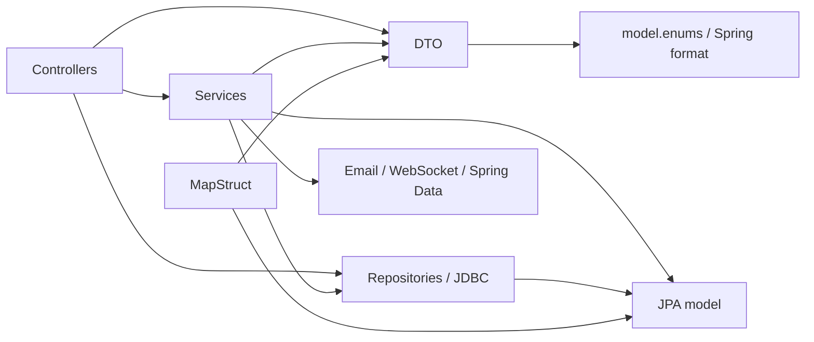

# Предварительный анализ текущего состояния

Срез: `master`, `5c71977`, 13.11.2026. Метод: статическое чтение исходников, POM, Dockerfile, workflow, документации и поиск issues. В `src/main/java` — 399 Java-файлов, в `src/test/java` — 147. Это количество файлов, а не оценка сложности или покрытия. Нагрузочные измерения, запуск приложения и поведение production в этом исследовании не проверялись.

## Что подтверждено кодом

Пути Java ниже отсчитываются от `src/main/java/com/padle/core/padelcoreservice/`.

| Область | Свидетельство | Следствие для переноса |
|---|---|---|
| Сборка | [pom.xml](../../pom.xml): один проект, Java 17, Spring Boot 4.1.2, MapStruct; нет `<modules>` и OpenAPI generator | Нужны родительский POM, reactor и один исполняемый модуль; upgrade стека отдельно |
| Контракты | `dto/`: 72 файла; `dto/TournamentDto.java` использует `model.enums`, Spring format и Jakarta validation | Простое выделение DTO потянет model и Spring; API-модели нужно отделить от доменных типов и MVC form-моделей |
| Сценарии | `service/TournamentService.java`: 1718 строк, импорты DTO, entity, Spring Data Page/Specification и репозиториев | Начать с одного сценария и порта; перенос целого сервиса не создаёт независимое ядро |
| Форматы | `KingOfCourtService`, `americano/AmericanoService`, `TeamPlayoffService`, `BracketService` совмещают вычисления с хранением | Эти сервисы нельзя целиком объявить движками |
| Готовые вычисления | `service/americano/AmericanoScheduleEngine.java` и `service/KingOfCourtPairingEngine.java` импортируют JDK-типы; `PlayoffMatchingEngine` дополнительно использует Spring `@Component` | Хороший начальный пилот; регистрацию Spring-компонента можно вынести в конфигурацию |
| Прямой доступ к БД | Импорты repository в `controller/admin/AdminKingOfCourtController.java`, `controller/view/americano/TeamPlayoffViewController.java`; `controller/test/TestTournamentController.java` использует `DataSource` | Нужны сценарии чтения/записи; запрет обхода портов должен учитывать тестовые/preview-адаптеры |
| Маппинг | `mapper/TournamentMapper.java` связывает `model/Tournament` и `dto/TournamentDto` | Разделить entity ↔ domain в persistence и domain ↔ API во входном адаптере через MapStruct |
| Identity | `model/PlayerPadel.java` — одновременно `@Entity` и `UserDetails` | Нужен отдельный principal; JPA entity не должна попасть в API порта и ядро |
| История и очки | `service/conduct/AdditionalPointsStore.java` содержит `JdbcClient` и использует DTO Stage | Историю/корректировки выделять через отдельные порты; сохранять атомарность с игровым состоянием |
| Маркетинг | `model/Payment.java` связывается с `marketing/MarketingEntityListener`; `marketing/` содержит контроллеры, SQL и доставку | Делить по ролям адаптеров, сохраняя запись журнала/outbox в той же транзакции |
| Ресурсы | [changelog-master.yaml](../../src/main/resources/db/changelog/changelog-master.yaml), templates, static/app; React собирается Maven-плагином в generated-resources | Сохранить пути ресурсов в classpath и ровно одно выполнение генерации/сборки |
| Доставка | [Dockerfile](../../Dockerfile) копирует корневые POM/src и выбирает `target/*.jar`; workflow используют корневые target-пути | Reactor требует согласованного обновления путей в той же работоспособной задаче |

В верхнем уровне пакетов: service — 74 файла, controller — 69, model — 39, repository — 24, mapper — 20. Это ориентиры для полной инвентаризации, не готовая карта переноса каждого класса.

## Текущий граф: характерные связи

Граф показывает найденные виды связей, не все рёбра каждого класса. Полный отчёт импортов, транзакций и Spring wiring — результат подготовительного этапа P0 в плане.

## Контракт уже существует частично

В [frontend-react/contract/](../frontend-react/contract/) есть `account.openapi.json`, `public-discovery.openapi.json`, `public-live.openapi.json`. В `frontend/src/api/` находятся рукописные TypeScript-типы и клиенты. В `frontend/package.json` нет команды генерации OpenAPI; в корневом POM нет springdoc и генератора. Это не доказывает отсутствие любых внешних скриптов; единого воспроизводимого конвейера Java DTO по этим файлам пока не установлено.

[ADR фронтенда 0004](../frontend-react/adr/0004-api-only-boundary-openapi.md) со статусом «Предложено» описывает Java → OpenAPI → TypeScript и отвергает contract-first на тогдашнем этапе. Новый запрос предполагает обратное направление OpenAPI → Java. Нужны явный новый ADR и сверка фактических JSON с ответами endpoint-тестов. [ADR 0002](../frontend-react/adr/0002-frontend-folder-not-maven-module.md) оставляет backend multi-module отдельной будущей задачей; frontend остаётся самостоятельным pnpm-проектом.

## Документы и доменные границы

[MASTER](../../specs/MASTER.md) и старый план обсуждают будущее выделение Payments, Notifications, Identity и турнирных доменов. Пять технических Maven-модулей не заменяют эти домены: внутри нужны пакеты и проверяемые границы. Сейчас нет оснований менять правила регистрации, резерва, платежей, доступа по клубу или восстановления истории.

В [architecture.md](../architecture.md) описан доступ TestTournamentController к JDBC, но схема слоёв упрощает прямые обращения других контроллеров к repository. Старый план рассматривает мобильный клиент как будущее направление; текущая точка отсчёта уже включает `mobile-app/`. Текущее исследование дополняет эти документы, а фактическую карту реализации нужно обновлять вместе с переносом.

## Что ещё требуется доказать

- Полный граф импортов, циклы между сервисами и принадлежность всех config/security/validation/metrics/preview-классов.
- Все границы транзакций, lazy loading, блокировки, callback/outbox, события после commit и Spring AOP.
- Исходный набор сквозных проверок и время сборки; числовые цели не назначены без измерений.
- Совместимость выбранного генератора с Java 17, Jakarta, Jackson 3, record-требованиями проекта и MapStruct.
- Полная карта зависимых путей: workflow, Docker, release, preview, скрипты, docs-drift и агентская автоматизация.

Поиск issues по модульности не выявил прямого дубля подготовки; #1040 посвящён Swarm, #1012 — административному React-пилоту. Перед созданием дочерних задач повторить поиск, включая английские термины и открытые PR.

## Уточнения владельца после первичного анализа

13.11.2026 согласованы Spring в application, API/domain/entity, OpenAPI → generated Java без record/коммита результата, отсутствие микросервисной реализации, малый пилот и отдельная e2e-задача #1045. Ограничение пятью модулями снято; предложены семь. Выделение persistence/Liquibase позднее; пилот БД не перемещает. [Актуальные решения](questions-and-risks.md), [история кандидатов](pilot-and-e2e.md). Первоначальные сведения об отсутствии согласования направления выше относятся к состоянию до этого ответа владельца.

## Детальный срез первой фазы после подтверждения

Семь модулей и пилот PlayoffMatchingEngine приняты владельцем. Подробный анализ обновлён на актуальный локальный master 5980db3: 408 main Java-файлов, 148 test. [Код/потребители/сборка/доставка](phase-1/code-analysis.md), [пул задач](phase-1/README.md), [25 проверочных сценариев](phase-1/test-cases.md). Исходные исторические числа выше не являются текущей полной инвентаризацией. Проверенные remote blob пилота/ключевых сборочных файлов совпали с локальными; 8 unit-тестов движка выполнены успешно. Общая интеграционная и ручная приёмка ещё не выполнялись.
