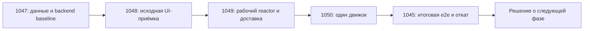

# Фаза 1: рабочая модульная сборка и пилот PlayoffMatchingEngine

Согласовано владельцем 13.11.2026: семь целевых модулей, практичный Spring в application, API/domain/entity, OpenAPI → generated Java без обязательного record/коммита результата, малый пилот PlayoffMatchingEngine и сохранение работы приложения после каждой задачи.

Фаза ограничена подготовкой проверок, двумя дочерними Maven-модулями и одним алгоритмом. Она не создаёт сразу все семь модулей, не включает API codegen и не выделяет хранение. Бизнес-правила, источники данных, Liquibase paths и PostgreSQL сохраняются.

## Анализ и проверки

- [Подробный анализ кода и путей](code-analysis.md).
- [Матрица кейсов и уровней проверки](test-cases.md).
- [Исходный backend-отчёт, артефакты и данные пилота](backend-baseline.md).
- [Browser/API baseline и известные дефекты](browser-baseline.md), [эталон](browser-expectations.json), [ручной чек-лист и журнал](manual-baseline.md).
- [Переходная раскладка и реестр — ADR-0006](../adr/0006-phase-one-layout.md).
- [Целевая архитектура](../target-architecture.md) и [ADR](../adr/README.md).

## Пул задач и порядок

| Задача | Слой | Результат | Зависит от | Объём |
|---|---|---|---|---|
| [LFPT-1047](https://github.com/UstinKO/padel-core-service/issues/1047) | backend | Исходные unit/integration/verify и fixtures 8/9/16, роли, история/ошибки | Решения #1041 уже приняты | M |
| [LFPT-1048](https://github.com/UstinKO/padel-core-service/issues/1048) | frontend | Скрипты/Playwright и отдельный ручной исходный отчёт | #1047 | M |
| [LFPT-1049](https://github.com/UstinKO/padel-core-service/issues/1049) | backend | Рабочий reactor, bootstrap, engines, вся доставка и smoke; движок ещё прежний | #1048 | L |
| [LFPT-1050](https://github.com/UstinKO/padel-core-service/issues/1050) | backend | Только engine/unit в engines, один Spring bean, прежнее поведение | #1049 | S–M |
| [LFPT-1045](https://github.com/UstinKO/padel-core-service/issues/1045) | frontend | Финальная автоматизированная и ручная e2e, откат, выводы | #1050 | M |

Оценки относительные, сроки не назначены. #1047 в master. Автоматизация #1048 выполнена, эталон и отчёт сохранены. Владелец принял ручные 8/9 пар вместе с полной автоматизацией; остальные ручные пункты остаются NOT_RUN и перенесены в #1045. После успешного CI и мержа #1070 можно начинать #1049. #1048 закрывается исходным прогоном, не ждёт финала пилота. #1045 — итоговая приёмка после переноса.

Каждое изменение самостоятельно проверяется и может быть выпущено; финальная приёмка не разрешает оставлять #1049/#1050 сломанными. У backend-задач обязательны общий verify и runtime smoke, у frontend-задач — реальный браузер и отдельный ручной отчёт. Обнаруженные блокирующие регрессии исправляются до продолжения, без переноса ответственности на следующую задачу.

## Отдельная поздняя задача хранения

[LFPT-1051](https://github.com/UstinKO/padel-core-service/issues/1051) — выделение persistence/JPA/JDBC/Liquibase. Выполняется после готовности портов и графа данных: в конце миграции либо в согласованном окне [Swarm #1040](https://github.com/UstinKO/padel-core-service/issues/1040). Не предшествует пилоту.

Это перенос кода/ресурсов в Maven-модуль. Физическая PostgreSQL/тома/данные при необходимости относятся к самостоятельной инфраструктурной постановке из #1040. Совпадение окна не отменяет отдельных репетиций и точек отката. Пока место в очереди/port-issues не определены, #1051 имеет draft-спеку.

## Завершение фазы

- Все пять задач завершены с отчётами на последних проверенных SHA/артефактах.
- Движок/test имеют одного владельца, engine не зависит от Spring/JPA; runtime ровно один bean, один boot jar.
- Архив выпуска, Docker/preview, frontend/static/templates/Liquibase и откат проверены; приложение целиком работоспособно.
- Исходная и итоговая матрицы пройдены скриптами и отдельно вручную; блокирующих регрессий нет.
- В документах отражены фактические два дочерних модуля и временный legacy src; семь — целевая структура, не заявление о завершённом переносе.
- Уроки/ограничения пилота учтены перед постановкой следующих доменных срезов. Закрытие подготовительной #1041 при мерже документации не подменяет завершение фазы; следующую подготовку доменных срезов ставить отдельно по результатам пилота.

Выполнены анализ и backend-подготовка #1047, затем автоматизированная browser/API матрица #1048 с исходным дефектом #1067. Reactor и перенос движка не начинались. Вручную пройдены 8/9 пар; этот объём принят владельцем для #1048. Полная ручная приёмка остаётся #1045, автоматизация её не заменяет.
