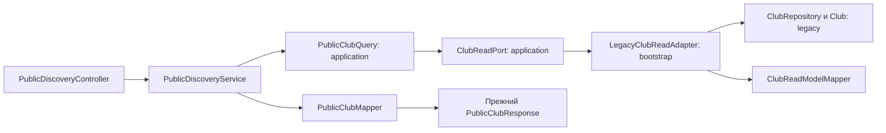

# Чтение публичных клубов в application — LFPT-1199

Срез ограничен существующими `GET /api/public/clubs` и `GET /api/public/clubs/{id}`. Условие старта выполнено: #1198 включена через #1232, [приёмка #1045 принята владельцем](../phase-1/followup-2026-11-20.md). Реализация оформляется отдельным backend PR поверх #1180; протокол приёмки и его frontend-проверки не объявляются объёмом backend-переноса.

## Вызовы и владельцы



Новый library-модуль `padel-application` содержит `com.padle.core.application.clubs`: `PublicClub`, `ClubReadPort`, `PublicClubQuery`. Read-модель — record из восьми публичных полей; JPA entity, HTTP DTO и canonicalUrl в ней отсутствуют. CanonicalUrl по-прежнему строит web-маппер из действующего baseUrl и ID, включая прежнее удаление завершающих слешей.

Порт запрашивает только активные клубы, список — в порядке имени и ID. Адаптер сохраняет прежние `findByIsActiveTrue(Sort.by("nombre", "id"))` и `findByIdAndIsActiveTrue`; фильтрация/сортировка остаются запросами БД. MapStruct преобразует entity в read-модель, затем отдельный MapStruct web-маппер преобразует её в прежний response. Для отсутствия результата application возвращает Optional; прежний web-адаптер формирует `CLUB_NOT_FOUND`.

`PublicClubQuery` — один Spring service с `@Transactional(readOnly = true)`. Bootstrap регистрирует его явным `@Import` в `PublicClubApplicationConfiguration`, не расширяя общий component scan. Адаптер — один bean в legacy bootstrap. Вызовы идут через Spring proxy, включая прямое обращение к сценарию вне транзакции теста. Существующая внешняя readOnly-транзакция `PublicDiscoveryService` присоединяется к тому же физическому контексту.

## Границы и переходные мосты

| Объект | Текущий владелец | Следующий шаг |
|---|---|---|
| PublicClubQuery, ClubReadPort, PublicClub | application | Сохраняются собственной границей чтения |
| LegacyClubReadAdapter, ClubReadModelMapper | Единственное корневое src, компилируемое bootstrap | Поздняя #1051 переносит реализацию хранения после проверки графа |
| ClubRepository, entity, Liquibase | Прежний legacy bootstrap | Поздняя #1051; физическая БД не переносится |
| PublicDiscoveryController/Service и HTTP-маппер | Прежний web-код bootstrap | Web выделяется отдельными срезами; catalog/home здесь остаются прежними |
| PublicClubResponse | Прежний HTTP record bootstrap | Generated API DTO — отдельная #1200 после #1199 |

Application имеет compile-зависимости только на Spring context/transaction и их инфраструктуру; ArchUnit разрешает производственному коду только собственные типы, JDK и согласованные service/transaction annotations. Enforcer запрещает обратные модули, Spring Data/MVC/Security, JDBC/ORM/JPA и Jackson. Порт не возвращает entity или старый HTTP DTO. Чистая модель и интерфейс порта не имеют Spring-зависимостей.

Запись клубов, клубные назначения, MVC `/clubs`, catalog/home, проведение турниров, API codegen, UI, ES/RU/EN, физическая БД и миграции не меняются. Отрицательный/нулевой ID сохраняет прежнюю обработку отсутствующего клуба; нового правила валидации нет.

## Сборка и проверка

Root reactor: engines → application → bootstrap; bootstrap зависит от обеих библиотек и остаётся единственным исполняемым jar. Dockerfile копирует POM/исходники application до соответствующих Maven-фаз. Пути legacy/resources/frontend, выпуск и Liquibase прежние.

```sh
./mvnw -B verify
python3 .github/bin/check-engine-artifact.py
python3 .github/bin/check-application-artifact.py
```

Новая artifact-проверка и PR Check подтверждают ровно одну `BOOT-INF/lib/padel-application-*.jar`, отсутствие копий application-классов в bootstrap, Java 17 bytecode и запрещённых ссылок. Отрицательные тесты проверяют shadow copy, отсутствие библиотеки, несовместимый bytecode и ссылки на запрещённые слои.

Проверки модуля охватывают отсутствие результата, nullable-модель и архитектурную границу. Интеграционные проверки проходят настоящие репозитории/PostgreSQL и отдельные commit-транзакции синтетических fixtures: активность, сортировка, один bean/proxy, readOnly, девять JSON-полей, null/canonicalUrl/headers, пустой список, неизвестный/неактивный/нулевой/отрицательный ID, неверный тип ID и отказ хранения. Имя клуба уникально по действующей схеме; secondary sort `id` сохраняется и проверяется по запросу, без создания недопустимых дублей.

Итоговый runtime/browser/rollback-отчёт добавляется после проверки конечного артефакта. Возврат выполняется прежним jar на той же синтетической БД; новых миграций и изменений данных этот перенос не требует.
