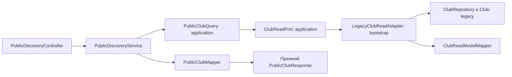

# Чтение публичных клубов в application — LFPT-1199

Срез ограничен существующими `GET /api/public/clubs` и `GET /api/public/clubs/{id}`. Условие старта выполнено: #1198 включена через #1232, [приёмка #1045 принята владельцем](../phase-1/followup-2026-11-20.md). Реализация оформляется отдельным backend PR поверх #1180; протокол приёмки и его frontend-проверки не объявляются объёмом backend-переноса.

## Вызовы и владельцы



Новый library-модуль `padel-application` содержит `com.padle.core.application.clubs`: `PublicClub`, `ClubReadPort`, `PublicClubQuery`. Read-модель — record из восьми публичных полей; JPA entity, HTTP DTO и canonicalUrl в ней отсутствуют. CanonicalUrl по-прежнему строит web-маппер из действующего baseUrl и ID, включая прежнее удаление завершающих слешей.

Порт запрашивает только активные клубы, список — в порядке имени и ID. Адаптер сохраняет прежние `findByIsActiveTrue(Sort.by("nombre", "id"))` и `findByIdAndIsActiveTrue`; фильтрация/сортировка остаются запросами БД. MapStruct преобразует entity в read-модель, затем отдельный MapStruct web-маппер преобразует её в прежний response. Для отсутствия результата application возвращает Optional; прежний web-адаптер формирует `CLUB_NOT_FOUND`.

`PublicClubQuery` — один Spring service с `@Transactional(readOnly = true)`. Bootstrap регистрирует его явным `@Import` в `PublicClubApplicationConfiguration`, не расширяя общий component scan. Адаптер — один bean в legacy bootstrap. Вызовы идут через Spring proxy, включая прямое обращение к сценарию вне транзакции теста. Существующая внешняя readOnly-транзакция `PublicDiscoveryService` присоединяется к тому же физическому контексту.

## Границы и переходные мосты

| Объект | Текущий владелец | Следующий шаг |
|---|---|---|
| PublicClubQuery, ClubReadPort, PublicClub | application | Сохраняются собственной границей чтения |
| LegacyClubReadAdapter, ClubReadModelMapper | Единственное корневое src, компилируемое bootstrap | Поздняя #1051 переносит реализацию хранения после проверки графа |
| ClubRepository, entity, Liquibase | Прежний legacy bootstrap | Поздняя #1051; физическая БД не переносится |
| PublicDiscoveryController/Service и HTTP-маппер | Прежний web-код bootstrap | Web выделяется отдельными срезами; catalog/home здесь остаются прежними |
| PublicClubResponse | Прежний HTTP record bootstrap | Generated API DTO — отдельная #1200 после #1199 |

Application имеет compile-зависимости только на Spring context/transaction и их инфраструктуру; ArchUnit разрешает производственному коду только собственные типы, JDK и согласованные service/transaction annotations. Enforcer запрещает обратные модули, Spring Data/MVC/Security, JDBC/ORM/JPA и Jackson. Порт не возвращает entity или старый HTTP DTO. Чистая модель и интерфейс порта не имеют Spring-зависимостей.

Запись клубов, клубные назначения, MVC `/clubs`, catalog/home, проведение турниров, API codegen, UI, ES/RU/EN, физическая БД и миграции не меняются. Отрицательный/нулевой ID сохраняет прежнюю обработку отсутствующего клуба; нового правила валидации нет.

## Сборка и проверка

Root reactor: engines → application → bootstrap; bootstrap зависит от обеих библиотек и остаётся единственным исполняемым jar. Dockerfile копирует POM/исходники application до соответствующих Maven-фаз. Пути legacy/resources/frontend, выпуск и Liquibase прежние.

```sh
./mvnw -B verify
python3 .github/bin/check-engine-artifact.py
python3 .github/bin/check-application-artifact.py
```

Новая artifact-проверка и PR Check подтверждают ровно одну `BOOT-INF/lib/padel-application-*.jar`, отсутствие копий application-классов в bootstrap, Java 17 bytecode и запрещённых ссылок. Отрицательные тесты проверяют shadow copy, отсутствие библиотеки, несовместимый bytecode и ссылки на запрещённые слои.

Проверки модуля охватывают отсутствие результата, nullable-модель и архитектурную границу. Интеграционные проверки проходят настоящие репозитории/PostgreSQL и отдельные commit-транзакции синтетических fixtures: активность, сортировка, один bean/proxy, readOnly, девять JSON-полей, null/canonicalUrl/headers, пустой список, неизвестный/неактивный/нулевой/отрицательный ID, неверный тип ID и отказ хранения. Имя клуба уникально по действующей схеме; secondary sort `id` сохраняется и проверяется по запросу, без создания недопустимых дублей.

## Результат 20.11.2026

[Машинная сводка](application-club-read-qa-2026-11-20.json). Проверенный implementation revision — `08d6dd96f4f48df291eb016f1dd7567957a036ae`, jar SHA-256 `0b9dbea3d26c13a423d0767a333ec96ed9c8381112a30b9b9ca2d3ff214d0751`. После этого меняются только проверка архитектуры и отчёт, production-код артефакта сохранён.

- Корневой verify с frontend на отдельной PostgreSQL: **1114 тестов**, 0 failures/errors, 2 штатных пропуска (bootstrap 1101, application 3, engines 10). Усиленный ArchUnit отдельно повторён: собственные типы/JDK/Service/transaction разрешены, остальные Spring-стереотипы и JDBC запрещены.
- 5 тестов artifact-guard и 48 тестов relay прошли. Финальный jar содержит ровно одну application library без shadow-классов, с Java 17 bytecode и без запрещённых слоёв. Enforcer/dependency tree подтверждают Spring context/transaction и их зависимости, без MVC/Spring Data/JPA/JDBC/Jackson.
- Production Dockerfile целиком собран на Java 21; извлечённый из него jar также прошёл обе artifact-проверки. SHA-256 production jar — `aaf24351f5e06d6a4aed7604720d18ea67e3d35f5bf9b05424302dadd2982d0e`. Различие хеша двух сборок не выдаётся за побайтовую воспроизводимость jar.
- На одних синтетических данных сравнены новый jar и прежний принятый артефакт `8a9ee29e` / SHA-256 `5126f460d3771e22fc7fd7f22922476d5d17138f99d272bf7977f4ff7efd700c`: список, карточка, неизвестный и нечисловой ID, JSON/status/Content-Type/Cache-Control в RU/ES/EN совпали. Реальное переключение на прежний jar и штатный rollback сохранили пять snapshots, схему и Liquibase; окончательно возвращён новый jar.
- Chromium: шесть комбинаций 1440/390 × RU/ES/EN, список/карточка клуба, повторное открытие/refresh и фильтр каталога прошли; JavaScript errors — 0. Это действия агента; независимая приёмка #1201 не объявляется уже выполненной.
- Общий runtime smoke прошёл на новом jar: legacy/React/session/CSRF/роли, участие/отмена пары, JWT, турниры 8/9/16, квалификация, stale/replay и оба restore MESSAGE/конечный UI. Expo получил фактический API 200 с отрисовкой через QA-адаптер; обычный preview сохраняет ограничение Basic 401. Репетиция двух выпусков, HTTP-ошибок readiness/chunk, старого lazy chunk и восстановления журнала сохранила пять snapshots.

Частные наблюдатели использовали штатный release-механизм и проверяли реальные ответы в новом собственном preview; runtime, доступы, полные baseline-ответы и скриншоты не включены в Git. Локальные доказательства — `target/club-read-qa/`, `target/modular-pilot/`, `target/release-rehearsal/`. Исходный ручной стенд #1045 не изменён. Новых миграций нет; бизнес-инварианты, роли и переключатели UI сохраняются.

Два коммита реализации/QA сохраняют доступный SHA кода, из которого собран проверенный jar. PR зависит от принятого протокола #1180 и сохраняется отдельным стеком; перед переключением base на master требуется повторная проверка интеграции. Следующий шаг — #1200 после включения #1199, хранение остаётся поздней #1051.
