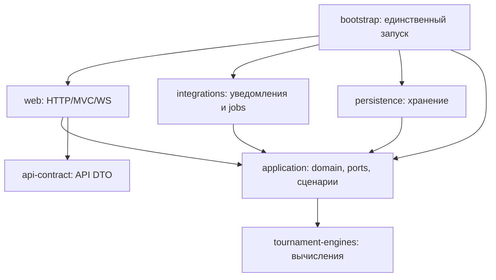

# Целевая архитектура: семь согласованных модулей

Статус на 13.11.2026: **Принято владельцем** — семь модулей, разделение API/domain/entity, Spring в application и OpenAPI → Java. Это целевая схема, а не уже реализованная структура. Корневой POM — агрегатор, отдельным runtime-модулем не считается.

| Модуль | Ответственность | Зависимости на свои модули |
|---|---|---|
| `padel-api-contract` | Канонический OpenAPI JSON, generated API DTO и wire-enum | Нет |
| `padel-tournament-engines` | Чистые вычисления и собственные минимальные входы/результаты | Нет |
| `padel-application` | Доменные модели, сценарии, политики, входные/выходные порты; Spring services и транзакции | engines |
| `padel-persistence` | JPA/JDBC, entities, Spring Data, адаптеры хранения, Liquibase, MapStruct entity ↔ domain | application; engines только при необходимости типов публичного API |
| `padel-web` | HTTP/MVC/WS, Security web-адаптеры, формы/view-модели, MapStruct domain ↔ API, STOMP publisher | application, api-contract |
| `padel-integrations` | Email/Telegram/CAPI и их конфигурация, фоновые входные адаптеры/scheduler | application |
| `padel-bootstrap` | Единственный main, связывание адаптеров, запуск, конфигурация и packaging ресурсов | application, web, persistence, integrations; contract/engines при необходимости wiring |

Основание выбора семи вместо исходных пяти — запуск и сетевые/фоновые адаптеры не разрастаются внутри модуля контроллеров. Не вводим отдельный domain-модуль сейчас: доменные пакеты в application остаются независимыми от Spring, но сценариям разрешены согласованные Spring-аннотации. Вводить все семь модулей сразу не требуется.

Стрелка означает compile/assembly-зависимость. Runtime-вызов application → порт → внедрённый persistence-адаптер не создаёт compile-зависимости application → persistence. Между модулями — обычные Java-вызовы в одном процессе. Внутренний HTTP, брокер, распределённые транзакции и отдельные runtime-сервисы не вводятся.

## Владение типами

- API DTO принадлежат contract и описывают внешний JSON; generated-классы не обязаны быть record. Рукописные DTO остаются под общим правилом CODE_STYLE. Формы Thymeleaf принадлежат web.
- Доменные модели/enum и нейтральные команды/результаты принадлежат application; без JPA, JDBC, Servlet, Spring Data, Jackson и Security principal. Не создаём три копии каждого класса заранее: модели отделяются по реальным границам переносимого сценария.
- Engines владеют небольшими алгоритмическими типами; не зависят от application, Spring, DTO или entity. Application преобразует доменное состояние во вход вычисления.
- JPA entity, lazy proxy и Spring Data остаются внутри persistence после его позднего выделения. Порты возвращают доменные снимки/read-модели без Pageable/Specification.
- Порты хранения и уведомления принадлежат application; интерфейс на каждую таблицу не требуется. Web формирует нейтральный контекст действующего лица; бизнес-права клуба проверяет сценарий.
- MapStruct: entity ↔ domain в persistence, domain ↔ API в web. У временного legacy-маппера есть потребитель и задача удаления.

## Spring, транзакции и ACID — согласовано

В application разрешены `@Service`, constructor DI, `@Transactional` и нужная для этих функций ограниченная Spring-инфраструктура. Запрещены инфраструктурные реализации и типы адаптеров. Чистые domain/engines остаются без Spring. Самостоятельная цель «удалить Spring из application» отсутствует.

Транзакция охватывает целый изменяющий сценарий. Сохраняются propagation, isolation, readOnly, rollback-правила, блокировки, flush и after-commit. Наличие `@Transactional` не доказывает ACID: нужны проверки proxy-вызова, отказа между записями, конкурентного изменения и гарантий БД. Игровое состояние, история, дополнительные очки и обязательный журнал/outbox сохраняются в одной требуемой транзакции. Внешний HTTP/email не становится атомарным с БД; сохраняем существующие механизмы after-commit/outbox.

## Переходный этап и БД

До выделения persistence существующие entities, repository, JdbcClient и Liquibase остаются в единственном корневом legacy src/, подключённом исполняемым bootstrap-модулем. Детальная промежуточная схема — [фаза 1](phase-1/code-analysis.md). Она реализует новые порты application. Application не импортирует legacy; мосты и исключения адресно учтены. Остальные старые сценарии сохраняются и работают. Выделение persistence — поздний этап, не условие пилота.

Перенос Java/ресурсов в Maven-модуль и перенос самой PostgreSQL/данных — разные операции. Владелец подтвердил отдельную позднюю задачу выделения хранения в Maven-модуль — #1051; возможный физический перенос PostgreSQL/данных в неё не включён. Физическая миграция БД не требуется для многомодульности. Возможное согласованное окно со Swarm обсуждается в #1040: подготовка, проверка нового приложения на прежней БД, затем отдельное инфраструктурное переключение. Совпадение окна выпуска не означает один непроверяемый большой шаг.

Сохраняются classpath-пути `db/changelog/**`, identity/checksum changeset и один запуск Liquibase. При позднем переносе нужны новая тестовая схема, схема предыдущего выпуска, повторный старт и откат jar на той же схеме. Боевая БД и её данные в текущей работе не затрагиваются.

## Контроль границ и возможное выделение

Внутри технических модулей сохраняются доменные пакеты registration, conduct, identity, clubs, payments, marketing и форматы турниров. Maven исключает циклы модулей; проверки пакетов запрещают controller → repository/entity, application → persistence/contract/web и engines → framework. Bootstrap зависит от адаптеров, а адаптеры от bootstrap не зависят. Конкретный инструмент проверки выбрать после оценки совместимости; Spring Modulith не является обязательной зависимостью ([возможности логических границ](https://docs.spring.io/spring-modulith/reference/fundamentals.html)).

Возможный будущий вынос оценивается по измеренной нагрузке/необходимости отдельного масштаба. До этого достаточно явных портов, небольшого публичного API и описанной ответственности за данные. Не обещаем независимость доменов, если они пока связаны общей транзакцией.
