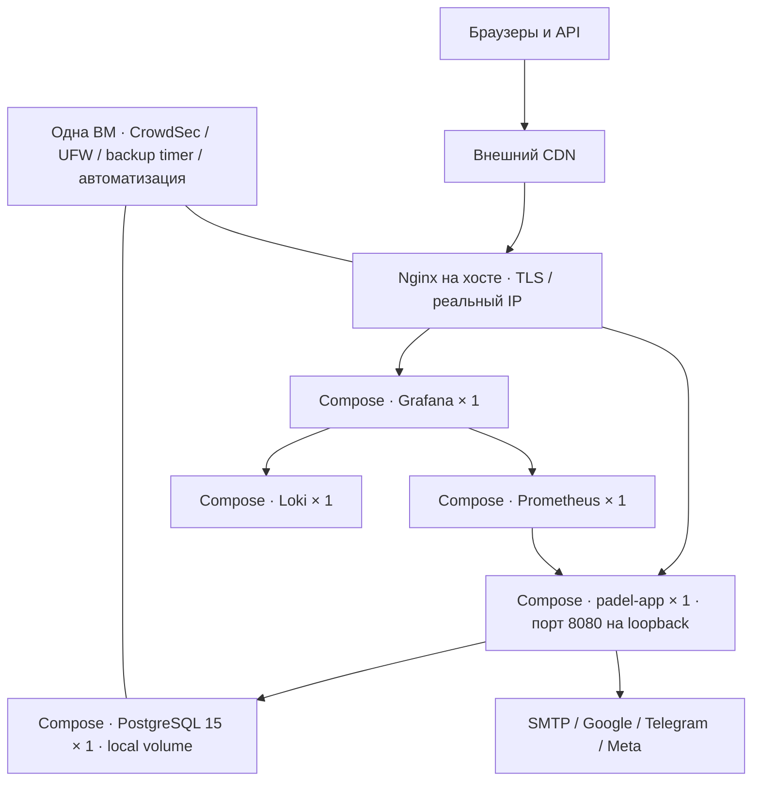

# Swarm на одной ВМ

Для следующего этапа подготовлена оценка устойчивости к потере целого провайдера. [Swarm на трёх ВМ, доступность данных и стоимость](../microservices/README.md)

[Локальный изолированный стенд LFPT-1208: запуск, проверка и очистка](lab.md).

[LFPT-1209: карта томов, backup/restore, репетиция и возврат данных](data-recovery.md).

Срез кода `315df3f5be7d008bd2751dc9597f849d5bf2ae40`, инвентаризация 19.11.2026, 10:24–10:27 UTC.
Работа выполнена по [LFPT-1207](https://github.com/UstinKO/padel-core-service/issues/1207)
в рамках [LFPT-1040](https://github.com/UstinKO/padel-core-service/issues/1040).
[ADR целевой схемы](adr/0001-single-vm.md) содержит технические решения и условия допуска.

## Актуальная схема · 20.11.2026

RabbitMQ исключён по замечанию техлида. Между app tasks выбран REST/JSON на
существующем HTTP-сервере (#1211), браузеры сохраняют WS/STOMP/SockJS.
Redis остаётся для сессий/квот. [Пересмотр ADR](adr/0001-single-vm.md),
[стенд без брокера](lab.md). Предыдущая реализация #1208 не считается принятой.

## Решения владельца

На одной ВМ в Swarm переходят padel-app, PostgreSQL, прокси и мониторинг.
Целевая численность приложения — две реплики. Цель — продолжать обслуживание при отказе
одного процесса приложения. PostgreSQL, прокси и мониторинг первоначально работают
по одному экземпляру. При отказе ВМ/Engine или общей зависимости приложение остаётся уязвимым.

Ориентиры при отказе реплики — обслуживание новых HTTP-запросов за 30 секунд,
восстановление актуального live-табло за 60 секунд и сохранение авторизации.
Запрос, выполнявшийся на упавшей реплике, может завершиться ошибкой. Повтор команды
должен сохранять ограничения вместимости, пары, резерв и оплаты.

## Схема текущего окружения

Схема отражает наблюдавшийся запуск. Контейнер Loki работает, но `LOKI_ENABLED=false`
у приложения. Фактическую доставку логов нельзя выводить из наличия контейнера Loki.

## Реестр подтверждённых фактов

| Область | Наблюдение | Источник |
|---|---|---|
| ВМ | Ubuntu 22.04.5 LTS, Linux 5.15, x86_64, 2 vCPU | SSH, uname/os-release/nproc |
| RAM и swap | 3911 MiB RAM, 2093 MiB available, 2047 MiB swap, 87 MiB swap занято | SSH, free -m, моментальный срез |
| Диск | 291 GiB всего, 165 GiB занято, 126 GiB свободно | SSH, df -h, округлённые значения |
| Engine | Docker 29.4.3, Compose v5.1.3, overlayfs, json-file, Swarm inactive | SSH, docker version/compose version/info |
| Текущий запуск | Одна реплика приложения, PostgreSQL, Loki, Prometheus, Grafana; рядом отдельная автоматизация с собственной БД | SSH, docker ps |
| Прокси и защита | Nginx 1.18.0 на хосте, CrowdSec/UFW active; в конфигурации есть TLS, real-IP и Upgrade | SSH, version, systemctl, разобранный nginx -T |
| Публикация портов | Порты приложения, БД и мониторинга в наблюдавшемся запуске привязаны к loopback | SSH, docker ps |
| Приложение | prod, порт 8080, Xmx=512 MiB, Xms=256 MiB, Hikari max=20/min=5; memory/CPU limits и Docker healthcheck отсутствуют | SSH, выборочные поля docker inspect |
| PostgreSQL | 15.17, max_connections=100, superuser_reserved_connections=3, 11 соединений включая диагностическое, 1 active; БД около 20 MB; plpgsql/unaccent | SSH, только SHOW и SELECT |
| Ресурсы контейнеров | JVM 734.1 MiB, PG 62.8 MiB, Loki 65.37 MiB, Prometheus 73.45 MiB, Grafana 56.52 MiB; автоматизация 23.44+16.36 MiB | SSH, docker stats --no-stream |
| Прокси RSS | Сумма RSS процессов Nginx около 52.9 MiB, возможен двойной учёт shared pages | SSH, ps |
| Нагрузка | Load average 0.32/0.59/0.64, memory PSI avg10=0 в момент проверки | SSH, /proc, без нагрузочного эксперимента |
| Данные | local volumes PostgreSQL ~75 MiB, Prometheus ~2.2 GiB, Loki ~77 MiB, Grafana ~1.8 MiB; логи приложения ~2.1 GiB | SSH, docker inspect и du |
| Backup | Ежедневный systemd timer около 03:00 по времени хоста; последний запуск exit=0/Result=success, 8 локальных зашифрованных файлов, последний ~1.28 MiB | SSH, systemctl и метаданные файлов |
| Backup-механизм | В действующем скрипте обнаружены pg_dump, age, rclone и retention | SSH, проверка наличия механизмов без вывода содержимого/адресатов |
| Выпуск | На сервере есть runner и каталог релизов; репозиторий проверяет манифест/образ, сериализует выпуск, выполняет smoke и rollback | SSH, проверка существования; automation/releases/transaction.py и docker_adapter.py |

SSH-сбор выполнялся после явно предоставленного владельцем доступа. Первый ED25519 ключ
принят при первом подключении и закреплён во временном локальном known_hosts.
Независимое сравнение fingerprint с консолью провайдера не выполнено.
Значения окружения отбирались по списку безопасных параметров. Полные inspect/env,
ключи, адрес сервера, адресаты backup и исходный nginx-конфиг в Git не сохраняются.

## Матрица переноса конфигурации

| Сейчас | Целевое действие | Проверка |
|---|---|---|
| Compose build и фиксированные container_name | Предварительный образ по digest, service/task identity | #1208, #1215 |
| bridge и depends_on healthy | Overlay и явная готовность зависимостей; готовность приложения проверяет релиз | #1208, #1216 |
| Наблюдавшиеся host-loopback порты | Публиковать только вход прокси, БД/метрики/внутренний REST внутри сетей | #1208 |
| Host Nginx и TLS-файлы | Перенести существующие правила в Nginx service, согласовать сертификаты/renewal и периметр | #1207 → #1208 |
| PostgreSQL local volume | Явное соответствие существующему external volume, единственный писатель | #1209 |
| Томa мониторинга | Сохранить реальные имена/содержимое, владельцев и retention | #1209 |
| logs/archive в общей папке | Развести логи по task или использовать stdout со сборщиком, исключить гонку ротации | #1216 |
| retained-assets read-only | Обеим репликам доступны ресурсы предыдущих релизов для открытых вкладок | #1215 |
| rating-pilot read-only | Инвентаризовать назначение и перенести mount в стенд/stack, если остаётся нужен | #1208 |
| Prometheus static padel-app:8080 | Обнаруживать и опрашивать каждую task отдельно | #1216 |
| .env и выборочные file secrets | Версионированные configs/secrets, доступ по сервисам, configtree для Spring после проверки | #1208, #1215 |

Фактические имена томов и приватные пути сохраняются оператором в закрытом протоколе #1209.
Публичный Compose объявляет логические имена, фактические production-тома имеют префикс
проекта. Использовать одно логическое имя без проверки фактического имени опасно.

## Состояние внутри процесса и проверки

| Риск | Подтверждение по коду | Условие допуска | Исполнитель |
|---|---|---|---|
| Сессии / OAuth2 / CSRF | SecurityConfig IF_REQUIRED, общего session store в зависимостях нет | Сессия A работает на B, OAuth2 callback на B и проверка logout/TTL | #1210 |
| WS | WebSocketConfig enableSimpleBroker | REST A → все peers; пропуски компенсируются ≤60 s, включая живое соединение | #1211 |
| Лимиты / IP | RateLimitFilter Guava/Bucket4j | Общая квота и блокировка, тест доверенной цепочки IP | #1212 |
| Cron / polling | @Scheduled и локальные sentReminders/lastUpdateId | Реестр job, атомарный claim, прогресс, crash/retry | #1213 |
| Дневная квота email | EmailMetricsService AtomicInteger | Суммарная квота провайдера соблюдается двумя процессами | #1213 |
| Meta queue | MarketingOutbox SKIP LOCKED и lease_until | Проверка истечения аренды, повторов и отказа доставки | #1213 |
| Вместимость / резерв / оплаты / результаты | Несколько путей JPA/JDBC, блокировки есть в отдельных методах | Конкурентные тесты с реальным PG и версиями состояния | #1214 |
| Liquibase и rollback | Старт приложения выполняет миграции | Повторный/параллельный старт, прежний JAR на новой схеме | #1214 |
| Выпуск | DockerAdapter ищет ровно один Compose container | Проверка всех tasks/ревизий и сохранение журнала/отката | #1215 |
| Readiness / graceful | Probes уже включены, effective production health и завершение не проверены | Измеренная детекция отказа ≤30 s, завершение HTTP/WS/async | #1216 |
| Общие зависимости | PG/Redis/прокси первоначально ×1; REST внутри app | Алерты, отказные проверки и инструкция восстановления | #1216, #1217 |
| Тома и backup | local driver, ежедневные архивы | Restore на отдельный том и возврат без двух писателей | #1209 |

Реестр scheduled по срезу включает TelegramBotPoller, TelegramReminderScheduler,
PairTournamentReminderScheduler, IndividualTournamentReminderScheduler,
SoloRegistrationSchedulerService, MetaDeliveryJob, MarketingContextService,
InternalAttributionService. Поиск `@Scheduled` в #1213 повторяется по всем модулям,
включая новые изменения после этого SHA. Очереди и async-задачи проверяются отдельно.

## Ресурсный расчёт

Владелец выбрал исходную ВМ с 4 GiB RAM (ОС видит 3911 MiB).
Моментальный срез не является P95/P99. Достаточность проверяется на стенде
с двумя JVM и полным набором общих сервисов.

| Шаг оценки | Доступная память, MiB |
|---|---|
| MemAvailable при одной JVM и действующих PG/мониторинге/Nginx | 2093 |
| Добавление второй JVM с наблюдавшимся потреблением 734 MiB | около 1359 |
| Дополнительный оценочный бюджет Redis 128 MiB без отдельного брокера | около 1231 до REST overhead |

Это оценка добавочного потребления относительно наблюдавшегося окружения.
PostgreSQL, мониторинг и текущий Nginx уже входят в исходное потребление ВМ.
Перенос прокси, процессы Swarm, warm-up, реальные размеры store и пики нагрузки
могут изменить результат. Оценка Redis 128 MiB не включает REST executor/retry/dedup
и сверку активных подписок; эти расходы измеряются в #1211/#1217.
Фактические limits/reservations выбираются после измерений.

Ранее использованная сумма отдельных максимальных бюджетов 4480 MiB не доказывает
обязательную потребность в таком объёме RAM. Одновременное достижение всех лимитов
не измерялось. Исходный ресурс стенда — 4 GiB, его увеличение рассматривается
отдельно только при подтверждённом дефиците.

Первый режим обновления — stop-first, parallelism=1. При двух репликах старая task
останавливается перед запуском замены, другая продолжает обслуживать запросы.
Start-first с временной третьей JVM требует отдельного измерения и ресурсного допуска.
Даже при текущей оценке третья JVM оставила бы около 497 MiB до REST overhead
после добавления store, что ниже предварительного порога 512 MiB.

CPU-бюджет стенда — JVM limit 1 CPU на task, PG 0.5, общие store/мониторинг/прокси
совокупно до 1 CPU. Это overcommit относительно 2 vCPU. Swarm reservations суммарно
должны помещаться в доступные CPU. Рабочие значения утверждаются после замера
одной оставшейся реплики на согласованной пиковой нагрузке. Доля занятого CPU
≤80% и MemAvailable ≥512 MiB на всём прогоне — предварительные пороги допуска;
дополнительно нужны фактические HTTP latency/error budget и отсутствие OOM.

PostgreSQL сейчас допускает 100 соединений, 3 зарезервированы для superuser.
При max pool 20 две JVM дают до 40, start-first — до 60.
Предлагаемый потолок прикладных/служебных соединений — 80 из 97 обычных слотов.
При трёх JVM остаётся 20 в этом бюджете для миграций, служебных клиентов и оператора.
Текущие 11 соединений включают приложение и диагностический запрос и не должны
прибавляться к 60 целиком. В #1214 проверить раздельный учёт пользователей/клиентов,
пулы других JDBC-клиентов и безопасное исчерпание лимита.
БД отдельной автоматизации работает в другом PostgreSQL и в этот лимит не входит.

126 GiB свободного диска — текущая ёмкость, стоимость image.tar, извлечённого образа,
предыдущих releases/assets, временной копии томов и backup пока не измерена.
Условие запуска миграции — после всех копий свободно ≥20% filesystem.
У #1209 обязательна ведомость размеров, у #1215 — retention релизов/образов/ассетов,
у #1216 — ротация логов и рост TSDB. Удаление старых данных входит в отдельное
согласованное обслуживание, инвентаризация его не выполняла.

## Время, потеря данных и неизвестные

| Показатель | Проектный ориентир | Что подтверждает |
|---|---|---|
| Отказ одной app task | Новые HTTP ≤30 s, табло ≤60 s | #1216, #1217 |
| Плановое первичное окно | Цель стенда ≤15 min от запрета записей до успешного smoke | #1209, #1217; дату окна согласует владелец в #1218 |
| Возврат образа приложения | Цель стенда ≤5 min, при совместимой схеме | #1215, #1217 |
| Restore PostgreSQL | Цель стенда ≤30 min после доступности проверенной копии | #1209, #1217 |
| RPO планового переноса | 0 подтверждённых записей при остановке записей и финальной согласованной копии | #1209, #1217 |
| Авария общей БД | Цель стенда RPO ≤24 h при исправном ежедневном backup и доставке | Доставка и restore проверяются в #1209 |

Владелец 19.11.2026 подтвердил цели стенда 15/5/30 минут и аварийный RPO ≤24 h
с обязательной проверкой. Результаты измерений фиксируются в #1209/#1217.
Фактическая дата production-переключения согласуется в #1218 после репетиции.
Для длительных операций HTTP и внешних уведомлений требуется отдельно определить
повтор и сверку результата.

| Неизвестное | Как получить ответ | Задача |
|---|---|---|
| Пиковая нагрузка, P95/P99 CPU/RSS/latency | Собрать историю и нагрузочный профиль, измерить failover | #1208, #1217 |
| Достаточность выбранных 4 GiB и лимитов store | Измерить реальные пики на стенде, включая старт, нагрузку и отказ реплики | #1208, #1217 |
| Полный restore и доступность offsite-копии/ключа | Оператор восстанавливает отдельный стенд, фиксирует время и сверку | #1209 |
| Список дополнительных правил прокси и других сайтов | Закрытая матрица vhost, TLS, ACME и CrowdSec/bouncer | #1208 |
| Работоспособность CrowdSec после контейнеризации Nginx | Replay безопасных запросов и проверка реального IP/банов | #1208 |
| Остаток root filesystem и retention release store | Read-only размеры + план хранения | #1209, #1215 |
| Effective health и остановка задач | Проверить runtime image и graceful под нагрузкой | #1216 |
| Версия production приложения относительно SHA анализа | Сверить manifest/revision во время репетиции | #1215 |
| Независимая проверка SSH host key | Сравнить fingerprint через консоль провайдера | Оператор до следующего доступа |

## Порядок и точки возврата

1. #1207 фиксирует исследование, решения и ограничения. #1208 создаёт полный изолированный
   Swarm-стенд с одной app task. Тома production изолированы от стенда.
2. После #1208 параллельно идут #1209 и #1210–#1214. Redis и подготовленная REST-сеть
   разворачиваются на стенде. Вторая task используется только для контролируемых проверок.
3. #1215 после #1209 доказывает выпуск/возврат. #1216 проверяет готовность и мониторинг;
   окончательная приёмка REST-наблюдаемости требует #1211.
   До допуска двух процессов используется stop-first.
4. #1217 после #1209–#1216 репетирует полный перенос, отказ task, зависимостей и возврат.
   Ошибка целостности данных или SLA останавливает продвижение.
5. #1218 в согласованное окно сохраняет финальную копию, останавливает старых писателей,
   подключает тома, переключает прокси/сервисы и выполняет smoke.
   До повторного открытия записей можно вернуться на старый stack/Compose с теми же
   проверенными данными. После открытия записей нельзя просто восстановить старый backup
   поверх новых данных. Требуется сверка новых записей и отдельное решение оператора.

Maven-работа #1051 сохраняет собственную репетицию и точку возврата. Перенос Java/JAR
сам по себе не меняет физические тома PostgreSQL. Перед реализацией дочерних задач
повторно сверить актуальные пути JAR и changelog.

## Обнаруженные расхождения документов

Историческая фаза 0 предполагала Nginx на хосте плюс Traefik и немедленный start-first,
четыре класса cron, ожидание строки Started и отсутствие probes.
Сейчас выпуск идёт через проверяемый release runner, probes уже объявлены,
реестр фоновых процессов шире, а владелец выбрал перенос прокси в Swarm.
В architecture.md прежняя безусловная фраза о loopback production заменена
наблюдением с датой. Старые параметры Compose не описывают все production mounts.

Источники реализации находятся в
[docker-compose.yml](../../docker-compose.yml),
[release adapter](../../automation/releases/docker_adapter.py),
[release transaction](../../automation/releases/transaction.py),
[deploy workflow](../../.github/workflows/deploy.yml),
[WebSocketConfig](../../src/main/java/com/padle/core/padelcoreservice/config/WebSocketConfig.java),
[RateLimitFilter](../../src/main/java/com/padle/core/padelcoreservice/security/RateLimitFilter.java),
[application.yml](../../src/main/resources/application.yml) и
[Prometheus](../../prometheus.yml).
