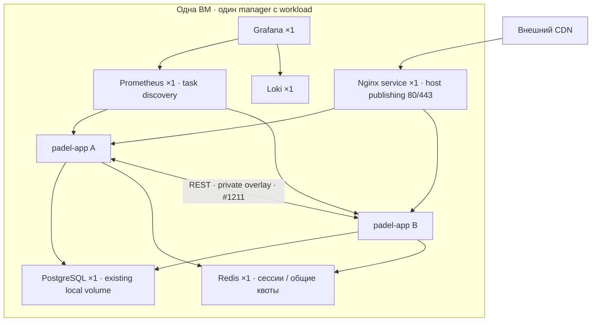

# ADR-0001 · Swarm на одной ВМ с двумя репликами приложения

Дата 19.11.2026. Основание — решения владельца в LFPT-1040 и задача
[LFPT-1207](https://github.com/UstinKO/padel-core-service/issues/1207).
Статус — целевая топология, исходные 4 GiB RAM и цели времени/RPO стенда согласованы
владельцем 19.11.2026. Технический выбор предложен для стенда.
Допуск production зависит от ресурсных и отказных проверок #1217.
[Факты, расчёты и неизвестные](../README.md).

## Контекст

Требуется обслуживать запросы после отказа одной JVM. На ВМ работают 2 vCPU и
3911 MiB RAM. Текущий монолит хранит HTTP-сессии, WS-подписки и часть квот/прогресса
в памяти. Исторический план предлагал Redis, RabbitMQ, ShedLock и Traefik.
Новые требования включают перенос PostgreSQL, прокси и мониторинга в Swarm.

## Выбранная схема

Менеджер единственный и выполняет workload. Это сохраняет выбранную одну ВМ.
Восстановление состояния менеджера и данных репетируется в #1209/#1217.
Расширение на несколько узлов потребует нового ADR с quorum и хранением.

## Сеть и прокси

Предлагается контейнеризировать Nginx с переносом действующих vhost, TLS, real-IP,
rate limiting, WebSocket Upgrade, таймаутов и интеграции CrowdSec. Traefik не добавляется
на этом этапе, поскольку существующие правила уже в Nginx, а дополнительный
прокси потребует отдельного переноса правил и доступа к Docker API.

На одной ВМ Nginx публикует 80/443 в host mode, число его задач — один.
Внутренние сервисы не публикуют host ports. Nginx балансирует к VIP сервиса приложения
в overlay. Длинные WS-соединения живут до разрыва и затем подключаются заново.
Swarm routing mesh для входа не требуется при одном узле. DNS/VIP и правила удаления
неисправных tasks проверяются реальным трафиком, readiness не считается автоматически
подключённой к Swarm маршрутизации.

Сети разделяют web/app, данные и мониторинг. Overlay encryption выбирается после
проверки поддержки Engine и стоимости CPU. Порты управления/overlay ограничиваются
периметром хоста. Docker socket доступен оператору/релизному адаптеру, прокси и
прикладные контейнеры не получают его mount. CrowdSec, UFW и renewal сертификатов
на хосте сохраняют операционные роли, интеграция с контейнерным Nginx проверяется
до переключения. Остальные сайты/службы хоста учитываются отдельно.

TLS-ключи и пароли переходят в Swarm secrets с выдачей по сервисам.
Конфигурация прокси и мониторинга версионируется через configs. Для Spring проверить
configtree и совместимость имён свойств, для PostgreSQL — поддерживаемый file-secret
вход. Уже существующий кластер БД не переинициализируется при смене способа передачи
пароля. Ротация — новый secret/config, rollout зависимых services, проверка старой
версии при rollback, затем отдельное удаление устаревших версий.

## Состояние приложения

| Решение для стенда | Причина | Альтернатива и цена |
|---|---|---|
| Spring Session с Redis | Общие сессии с TTL, поддержка servlet/OAuth2 state, единый store для квот | JDBC sessions экономят отдельный store, увеличивают БД-нагрузку; сравнить при нехватке RAM |
| Общие Bucket4j-квоты в Redis с атомарными операциями | Сохраняют квоту при чередовании реплик | Только внешний rate limit не покрывает все прикладные счётчики |
| REST/JSON между app tasks (#1211) | Использует существующий HTTP-сервер и локальный simple broker, без отдельного сервиса | gRPC требует proto/codegen/runtime; надёжность fan-out/retry/reconciliation всё равно реализуется приложением |
| PostgreSQL-backed координация отдельных jobs, ShedLock как кандидат | Позволяет координировать cron на уже имеющейся БД | Каждый job требует анализа claim/retry, одной аннотации недостаточно для отправок |
| MarketingOutbox claim/lease | Уже реализовано в БД | Дополнительный blanket-lock может лишить очередь предусмотренной конкуренции |

Redis первоначально ×1, внутри сетей, с ограничениями памяти,
метриками и проверкой восстановления. Их суммарное потребление и достаточный запас
на выбранных 4 GiB проверяются при запуске полного стека и под нагрузкой.
Пересмотр выбора store из-за памяти оформляется дополнением ADR до реализации.

Проверить сериализацию Spring Security principal и OAuth2 state между версиями.
Redis-перезапуск, срок сессии и persistence конфигурация требуют явной политики.
REST не хранит полное состояние табло — после пропуска требуется автоматическая
сверка с БД, включая зрителей с живым соединением без reconnect. Очереди уведомлений с доставкой
внешнему провайдеру требуют собственных гарантий повторов.

## Пересмотр 20.11.2026 · LFPT-1208 / LFPT-1211

По замечанию техлида RabbitMQ исключён: для текущих двух JVM отдельный брокер
не вводится. Redis остаётся store сессий/квот, не каналом Pub/Sub. Сравнение:

| Вариант | Дополнительная эксплуатация | Решение |
|---|---|---|
| RabbitMQ STOMP relay | Broker, volume, пароль, метрики, перезапуск; прежний stand limit 384 MiB | Отклонён для текущего этапа |
| REST/JSON | Bounded HTTP executor, DTO, service-auth; существующий сервер | Выбран, реализация #1211 |
| gRPC | Proto/codegen, stubs/runtime, поддержка RPC-контракта | Отложен до измеренной потребности |

Экономия от удаления broker limit не равна измеренной экономии RSS. Накладные
расходы REST, retry/dedup и сверки измеряются на двух процессах в #1217.
REST/gRPC сами по себе не дают broadcast, replay, exactly-once или общий порядок.
После commit отправитель доставляет локально и каждому peer по `tasks.padel-app`,
обновляя DNS. VIP балансирует, а не рассылает. Получатель публикует только локально,
без fan-out обратно. Нужны eventId/originInstanceId/schemaVersion, allowlist topic,
bounded timeout/retry/executor/dedup, авторизация ключом из Swarm secret и ротация.
Public proxy блокирует `/internal` и `/internal/**`; сеть не заменяет service-auth.
Ключ `/run/secrets/cluster-events-key` подготовлен стендом, текущий Java-код его
не читает: endpoint, контракт и ротация в приложении реализуются в #1211.

БД — источник истины. AfterCommit не закрывает crash между commit и HTTP-send.
В #1211 обязательна сверка активных live-подписок с БД при потерях/переполнении,
включая открытое табло B без reconnect, с восстановлением ≤60 s. Существующие
WS/STOMP topics, payload и права клиентов сохраняются. Проверяются KoC,
Team Playoff, public live и restore истории. При необходимости отдельного
frontend-контракта создаётся зависимость, блокирующая #1217/#1218.
SockJS transport-session локальна JVM; Redis HTTP-session её не разделяет.
Transport affinity и reconnect проверяются отдельно в #1211.

## Данные и миграции

PostgreSQL ×1 закрепляется за единственным узлом с проверенными данными. Stack
явно подключает существующий external local volume по имени из закрытой ведомости.
Одновременное монтирование одного data directory двумя PostgreSQL запрещается
процедурой переключения. Тома мониторинга переносятся аналогично.

Liquibase выполняет единственный логический набор changelog, блокировка и
параллельный старт проверяются. Старый JAR должен работать на новой схеме в окне
rollback, разрушительные изменения требуют expand/contract. Отмена образа
не отменяет SQL. Restore из копии после появления новых записей требует отдельной
сверки данных и решения по RPO.

## Выпуск и отказ

Образ собирается заранее и доставляется по неизменяемому digest. Для одной ноды
можно сохранить проверяемый архив image.tar и загрузку на Engine, сверяя фактически
использованный digest и task images. Если выбран registry, зафиксировать retention,
доступ менеджера и проверку совпадения digest. Сборка на production не требуется.

Swarm-адаптер сохраняет существующие манифест, retained assets, журнал и сериализацию.
Успех — готовая правильная ревизия всех требуемых tasks и пройденный smoke.
Для Nginx, БД и сервисов с единственным писателем применяется stop-first.
Для приложения первоначально stop-first с parallelism=1.
Start-first допускается после #1210–#1214, #1216/#1217 и подтверждения бюджета трёх JVM.
Rollback order проверяется отдельно, возврат двух ревизий не выводится из
одного только параметра Docker rollback_config.

Параметры healthcheck, monitor и stop_grace_period подбираются из измерений,
обеспечивая HTTP failover ≤30 s. Интервал и retries не задаются как доказательство
этого времени без эксперимента с зависшей task и контролем прокси.
Перезапуск task обеспечивается Swarm restart policy, количество 2/2 проверяется
релизным адаптером. Метрики — для каждой task и ревизии.

## Последствия и допуск

Дополнительные общие зависимости требуют памяти и эксплуатации.
Исходный ресурс стенда — выбранные владельцем 4 GiB RAM (3911 MiB доступны ОС).
Наблюдавшиеся MemAvailable=2093 MiB включают одну JVM, БД, мониторинг и текущий
Nginx. После второй JVM около 734 MiB и оценочного Redis 128 MiB
остаётся около 1231 MiB до накладных расходов REST и сверки. Достаточность этого запаса проверяется
при старте, пиковой нагрузке и отказе одной реплики.

Сумма консервативных максимумов всех компонентов не используется как требование
минимальной RAM. На первом этапе обновления выполняются stop-first, parallelism=1.
Start-first с третьей JVM допускается отдельно после измерений, поскольку текущая
оценка оставляет около 497 MiB ещё до накладных расходов REST. Увеличение ВМ рассматривается при измеренном дефиците.

Допуск production требует всех проверок #1209–#1217, восстановленного backup,
измеренного окна, суммарного пула PG ≤80 обычных клиентов, свободного диска ≥20%,
MemAvailable ≥512 MiB, отсутствия OOM и согласованного профиля нагрузки.
Владелец подтвердил цели стенда — первичное окно ≤15 min, возврат приложения ≤5 min,
restore БД ≤30 min и аварийный RPO ≤24 h при исправном ежедневном backup.
Проверка целей выполняется в #1209/#1217, дата production-окна согласуется в #1218.
Процедура приёмки приведена в реестре.

## Официальные основания

- Swarm stack требует предварительно собранный образ и проверки совместимости формата. [Docker stack deploy](https://docs.docker.com/engine/swarm/stack-deploy/)
- Публикация портов, локальные тома, placement, update и rollback задаются у service. [Docker services](https://docs.docker.com/engine/swarm/services/)
- Сессии servlet могут обслуживаться общим Spring Session store. [Spring Session](https://docs.spring.io/spring-session/reference/http-session.html)
- Локальный simple broker сохраняется; межрепличная пересылка REST реализуется приложением (#1211). [Spring Framework](https://docs.spring.io/spring-framework/reference/web/websocket/stomp/handle-broker-relay.html)
